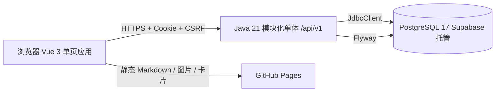

# NEST · 学巢

面向小规模家教场景的轻量学习平台：教师按学科开通课件、维护参考答案并批阅；学员阅读讲义、逐题作答，用错题本、签到、积分、收藏卡、成就与任务维持学习节奏。教师注册采用"提交申请 → 超级管理员审核 → 成为管理员"的受控流程。

前端 Vue 3 + Vite，后端 Java 21 + Spring Boot 4.1，数据库 PostgreSQL 17（当前由 Supabase 托管），结构由 Flyway 管理。

| 入口 | 地址 |
| --- | --- |
| 学员端 / 管理端前端 | `https://learn.be-young.top`（GitHub Pages） |
| Java API | `https://api.be-young.top/api/v1`（staging：`staging-api.be-young.top`） |

---

## 能力地图

### 学员端

| 页面 | 路由 | 能力 |
| --- | --- | --- |
| 首页 | `/` | 登录/注册、学科卡片、等级与进度、收藏卡预览、快捷入口 |
| 学科目录 | `/category?subject=` | 文章树、授权过滤、未完成提醒 |
| 文章详情 | `/blog/:id` | Markdown + KaTeX + 图片嵌入、双栏、目录、答题卡、逐题提交、查看批阅与答案、加入错题本 |
| 任务中心 | `/tasks` | 每日签到与月历、积分与等级、卡池抽卡（单抽/十连）、收藏室、成就、每日/每周/限时任务 |
| 错题本 | `/wrong-questions` | 筛选、错因/笔记/标签、掌握状态、手动收集与删除 |
| 错题训练 | `/wrong-training` | 重做错题、再次答错累加次数 |
| 账户设置 | `/settings/password` | 修改密码（撤销其他会话） |

### 管理端（`/admin`）

| 页面 | 能力 |
| --- | --- |
| 工作台 | 我的学员/总学员、近 7 天活跃、待批阅、近 7 日提交、待认领课件、30 天提交/批阅趋势、学员动态 |
| 学员 | **新增测试学员**（固定 `isTest=true`，不计入统计）、认领/取消认领、删除、设置初始密码/重置、**先开通科目再按篇授权**、进入学员账号、学员详情抽屉；未认领/他人认领的学员不可查看详情、设密、进入或删除，特殊测试学员不可删除 |
| 批阅 | 按学员/学科筛选；待批阅、已批阅、未提交、全部四种视图；查看作答与参考答案；正确/半对/错误三档批阅 |
| 课件 | 同步课件目录、认领/释放学科、单篇认领/释放（排除）、我的/待认领/全部目录、参考答案与自动批阅开关 |
| 注册审核 | **仅超级管理员（`young`）**：查看待审核/已通过/已驳回教师申请，通过后创建管理员账户，驳回需写理由 |
| 我的 | 管理员账户信息与密码 |

### 平台

- 身份：服务端会话 Cookie、CSRF、Argon2id 密码、激活码、限流；教师注册申请只存哈希，超级管理员审核通过后才建管理员账户。
- 授权：科目归属（`student.subjects`，只表示学哪几科）与内容授权（`student.permissions`，文章 ID 白名单）分离；学员认领（一人一管理员）、课件认领（学科多对多 + 单篇 + 排除）。
- 激励：签到（100/日，月度第 7/14 次 +100）、积分、抽卡（80/张、稀有 5%、UP 50%、ISO 周轮换）、7 类分级成就、9 项周期/限时任务、7 段成长等级（每 200 累计积分一级）。
- 运维：`/system/status`、liveness/readiness、Flyway 迁移、运行角色最小权限与 RLS、密钥扫描。

---

## 技术架构



- **前端**：Vue 3.4、Vite 5、Pinia、Vue Router（hash 模式）、Font Awesome、KaTeX（CDN）、marked。
- **后端**：Java 21 LTS、Spring Boot 4.1、Spring Security、JdbcClient；按业务能力分包：`identity`、`learning`、`wrongbook`、`checkin`、`rewards`、`growth`、`administration`、`system`、`shared`。
- **数据库**：PostgreSQL 17；Flyway `V1`–`V18`；应用使用受限角色 `tutor_base_runtime`（无 DDL 权限）。
- **测试**：Node Test（前端 gateway/工具）、JUnit + MockMvc + Testcontainers PostgreSQL、Playwright 端到端。
- **内容**：`public/articles/**/*.md` 为公开静态资源，构建前由脚本生成 `articles.json` / `id_map.json`。内容授权控制导航与学习数据，**不保证正文 URL 保密**。

---

## 快速开始

### 前置

- Node.js 20+（CI 使用固定 LTS）、npm
- Java 21（`java -version` 确认；不得用 Java 8 验证 Spring Boot 4）
- Docker Desktop（本地 PostgreSQL 与集成测试）

### 1. 安装前端依赖

```powershell
cd D:\01-项目\家教网站-vue\tutor-base
npm ci
```

### 2. 准备数据库（二选一）

**A. 本地 PostgreSQL（推荐用于开发）**

```powershell
docker run --name tutor-base-postgres `
  -e POSTGRES_DB=tutor_base_dev `
  -e POSTGRES_USER=tutor_base_dev `
  -e POSTGRES_PASSWORD=local-dev-password `
  -p 5432:5432 `
  -d postgres:17-alpine
```

以后启动：`docker start tutor-base-postgres`。

**B. 连接已有 Supabase 测试库**：把 `backend/.env` 指向该库的受限运行账号；若结构落后，见下文"数据库对齐"。

### 3. 启动后端（8080）

```powershell
cd backend
Copy-Item .env.example .env   # 首次
.\mvnw.cmd -B -ntp spring-boot:run
```

Spring Boot 会读取 `backend/.env`；系统环境变量优先级更高。首次启动由 Flyway 自动执行 V1–V18。

### 4. 启动前端（3000）

```powershell
cd ..
npm run dev
```

`predev` 会先同步文章索引。开发服务器把 `/api` 代理到 `http://127.0.0.1:8080`，无需处理 CORS。连其他后端时改 `tutor-nest-vue/.env.local` 的 `VITE_API_BASE_URL`，或设置 `VITE_DEV_API_TARGET`。

> 前端不持有任何数据库凭据；登录与业务数据全部经 `/api/v1`。

### 5. 冒烟检查

```powershell
Invoke-RestMethod http://localhost:8080/api/v1/system/status
Invoke-RestMethod http://localhost:8080/actuator/health/liveness
Invoke-RestMethod http://localhost:8080/actuator/health/readiness
```

期望：`status = ok`，两个健康检查均为 `UP`。全新本地库没有可直接登录的账号，管理流程建议先跑自动化契约测试或按 [`docs/bootstrap-administrator.md`](docs/bootstrap-administrator.md) 在受控环境自举管理员（生产库已完成，不得重复执行）。

---

## 数据库对齐（存量库）

应用角色**没有 DDL 权限**，不能自动建表。若 Supabase 库结构落后，接口会返回 `503 dependency_unavailable`（`permission denied for table ...` / `relation does not exist`）。

在 Supabase Dashboard → SQL Editor 用**数据库所有者 / postgres 角色**按需执行下列脚本（均可重复执行，按时间顺序）：

| 脚本 | 补齐内容 |
| --- | --- |
| `database/reconciliation/2026-08-15_align_existing_schema_through_v3.sql` | V1–V3 结构与约束对齐、`student → account` 回填 |
| `database/reconciliation/2026-08-17_points_and_collection.sql` | 积分与收藏基础表 |
| `database/reconciliation/2026-10-19_create_missing_learning_tables.sql` | `article_answer_keys`、`article_question_submissions`、`wrong_questions`、`task_claims`、`card_collection` 及索引/触发器 |
| `database/reconciliation/2026-10-19_growth_achievements_tasks.sql` | `achievement_claims`、`task_assignments`、扩展 `task_claims` |
| `database/reconciliation/2026-10-20_gacha_card_pool.sql` | `card_sets` / `card_definitions` 目录与种子、`lifetime_points`、`draw_count` |
| `database/reconciliation/2026-10-27_learner_claiming.sql` | `student.claimed_by/claimed_at`、配对约束、触发器、索引 |
| `database/reconciliation/2026-10-29_courseware_claiming.sql` | `courseware_catalog`、`admin_subject_claim`、`admin_courseware_claim` |
| `database/reconciliation/2026-10-30_courseware_exclusion.sql` | `admin_courseware_exclusion` |
| `database/reconciliation/2026-10-30_runtime_courseware_grants.sql` | 运行角色课件表权限与 policy |
| `database/reconciliation/2026-10-30_test_learners.sql` | `is_test` / `is_special_test` 标记与回填 |
| `database/reconciliation/2026-10-31_teacher_registration_review.sql` | `account.is_super_admin`、`teacher_registration_application`、待审核唯一索引、审核约束与运行角色授权 |

每轮结构变更后，再用 postgres 角色执行：

```text
database/operations/provision_runtime_role.sql
```

它给 `tutor_base_runtime` 授予 DML、序列与 RLS policy；否则接口仍会 503。执行后无需重启后端，刷新页面即可。授权与策略是否完整，用 `database/audit/runtime_role_checks.sql` 核对（所有 `anomaly_count` 应为 `0`）。

> 不要手工修改 `flyway_schema_history`，不要修改已执行过的 migration，也不要删除既有表。迁移是版本化历史，不能靠 `IF NOT EXISTS` 掩盖部分执行状态。

---

## 关键业务规则

| 规则 | 口径 |
| --- | --- |
| 身份 | 服务端 `HttpOnly` 会话 Cookie；写请求带 `X-CSRF-TOKEN`；密码 6–128、Argon2id；登录失败统一 `invalid_credentials` |
| 教师注册 | 勾选"我是教师"只提交 `POST /teacher-applications`，不建号、不建会话；审核通过才创建 `active` 管理员账户，驳回后可用同一用户名重新申请 |
| 超级管理员 | `account.is_super_admin=true` 且必须是管理员；当前为 `young`；只有该标记可查看/审核教师申请，普通管理员访问返回 `403 forbidden` |
| 内容授权 | `student.permissions` 是文章 ID 白名单；管理员替换授权只作用于"我的课件"，范围外保留 |
| 科目归属 | `student.subjects` 表示学员已开通的科目；开通科目**初始不授权该科目下任何文章**，文章仍需逐篇授权 |
| 我的课件 | (我认领学科的全部课件 − 我排除的课件) ∪ 我单篇认领的课件；学科认领自动覆盖未来新增课件 |
| 学员认领 | 一名学员至多一名管理员；新增测试学员由创建者自动认领；取消认领幂等；查看详情/设密/进入账号/删除都要求已认领 |
| 保存作答 | 每题保存"当前答案"，覆盖式；已批阅的作答不可再提交（`409 submission_already_reviewed`） |
| 自动批阅 | 有参考答案且 `auto_grade=true` 时，仅统一换行后完全匹配 → `correct` / `wrong`；否则 `pending` |
| 答案可见 | 学员只在该题已批阅后看到参考答案；管理员在自己的课件内可见 |
| 错题 | 判 `wrong` 自动收集/复活并把出错次数 +1；`mastered` 只置标记，不清零次数；手动条目硬删，自动条目软删 |
| 签到 | 每自然日（Asia/Shanghai）一次 +100；当月第 7、14 次额外 +100；同日重复幂等 |
| 积分 | `points` 可消费；`lifetime_points` 只增不减；等级 = `floor(lifetime/200)+1`，7 个段位 |
| 抽卡 | 80 积分/张，1–10 张；稀有 5%，命中稀有后 50% 为当期 UP；UP 按 ISO 周轮换（周一 00:00 Asia/Shanghai） |
| 任务/成就 | 目录由服务端决定；日/周任务按 Asia/Shanghai 刷新；限时任务需先接取；奖励领取与积分累加同一事务，唯一约束兜底 |
| 测试学员 | **管理端“新增测试学员”入口固定创建 `is_test=true` 学员**；`is_test` 不进入管理统计；特殊测试学员全局唯一、全课件、固定 `999999999` 积分且抽卡不扣，**不可删除** |
| 时区 | 传输 UTC（RFC 3339）；自然日/周按 `Asia/Shanghai` |

完整规则与边界见 [`docs/软件需求规格说明书.md`](docs/软件需求规格说明书.md)；对象与表映射见 [`docs/业务对象清单.md`](docs/业务对象清单.md)。

---

## 文档地图

| 文档 | 内容 |
| --- | --- |
| [`docs/文档索引.md`](docs/文档索引.md) | 文档索引、阅读路线、维护规则 |
| [`docs/软件需求规格说明书.md`](docs/软件需求规格说明书.md) | 软件需求规格：角色、12 个能力域、68 条功能需求、非功能需求、验收与追踪 |
| [`docs/用户故事.md`](docs/用户故事.md) | 60 条用户故事与 Given/When/Then 验收标准 |
| [`docs/业务对象清单.md`](docs/业务对象清单.md) | 45 个业务对象、状态机、表/接口/前端映射、25 条不变量 |
| [`CONTEXT.md`](CONTEXT.md) | 领域词汇与"避免叫法"，术语唯一来源 |
| [`docs/api-standards.md`](docs/api-standards.md) | 协议、错误码、分页、并发与目标接口目录 |
| [`backend/api/openapi.yaml`](backend/api/openapi.yaml) | 机器可校验接口契约（46 个路径） |
| [`docs/code-standards.md`](docs/code-standards.md) | 工程结构、Java/前端规范、测试分层、安全 |
| [`docs/design-system.md`](docs/design-system.md) | Riso Campus 视觉契约与组件类 |
| [`docs/backend-completion-matrix.md`](docs/backend-completion-matrix.md) | 能力接管状态与完成所需验证 |
| [`AGENTS.md`](AGENTS.md) | 协作流程、必须同步维护的契约、CI/CD 分工 |
| [`backend/README.md`](backend/README.md) | 后端启动、身份/CSRF、迁移、接口细节 |
| [`deploy/README.md`](deploy/README.md) | 服务器部署、迁移、健康检查、回滚 |
| [`tutor-nest-vue/README.md`](tutor-nest-vue/README.md) | 前端结构、文章编写规范、路由与模式 |

---

## 目录结构

```text
tutor-base/
├─ tutor-nest-vue/           Vue 前端
│  ├─ public/articles/       讲义 Markdown（按学科分目录）
│  ├─ public/data/           自动生成的 articles.json / id_map.json
│  ├─ public/cards/          收藏卡图片
│  ├─ src/assets/theme.css   设计 token（Riso Campus）
│  ├─ src/views/             页面：首页/目录/文章/任务/错题/训练/管理台
│  ├─ src/components/        admin / articles / tasks / common / ui
│  ├─ src/gateways/          按能力划分的 API 客户端
│  ├─ src/stores/            Pinia 状态
│  ├─ e2e/                   Playwright 全链路用例
│  └─ scripts/               文章索引同步
├─ backend/                  Java 模块化单体
│  ├─ api/openapi.yaml       接口契约
│  └─ src/main/resources/db/migration/  Flyway V1–V18
├─ database/                 审计、对齐、授权脚本
│  ├─ reconciliation/        存量库幂等对齐
│  ├─ operations/            运行角色授权 / 浏览器权限收口
│  └─ audit/                 只读检查 SQL
├─ deploy/                   compose、smoke test、部署手册
├─ docs/                     需求、故事、对象、契约与运维手册
└─ scripts/                  SFC 检查、E2E 启动、密钥扫描
```

---

## 常用命令

```powershell
npm run dev            # 本地开发（含文章索引同步）
npm run build          # 生产构建（含同步）
npm run preview        # 预览构建产物
npm run check:sfc      # SFC/模板编译检查（不写文件）
npm run test:frontend  # 前端 gateway/工具测试
npm run test:openapi   # OpenAPI 规范校验
npm run test:secrets   # 仓库密钥扫描
npm run test:e2e       # Playwright 用户旅程
```

```powershell
cd backend
.\mvnw.cmd -B -ntp test     # 单元 + HTTP 契约（需要 Docker 时自动启用集成测试）
.\mvnw.cmd -B -ntp verify   # 含 Testcontainers PostgreSQL 的完整验证
```

本地一键跑"临时 PostgreSQL + 管理员自举 + 后端 + Vue + Playwright"：

```powershell
.\scripts\e2e-local.ps1
```

---

## 质量门与部署

**CI（`.github/workflows/backend-ci.yml`，工作流名 `CI`）**：PR 与 `main` 统一质量门，5 个并行 job——secret 扫描、Java 单元测试、HTTP/PostgreSQL 集成测试、前端测试/构建、浏览器 E2E；各自独立失败状态。

**后端 CD（`backend-deploy.yml`，`Backend CD`）**：仅 `main` 的 `CI` 成功后运行；发布或复用不可变 commit SHA 镜像 → 进入 `staging` Environment（保护规则按仓库设置）→ 迁移 → 替换 → readiness + smoke → 失败自动回滚旧镜像。

**前端 CD（`deploy.yml`，`Pages CD`）**：仅 `main` 的 `CI` 成功后构建同一 commit 并发布 GitHub Pages。

约定：

- 数据库迁移先于应用替换；失败保留可执行回滚路径。
- 生产 secret 只存在 GitHub Environment / 服务器受限 env 文件。
- 前端发布地址由工作流按自定义域名计算 `base`，无需手工改 Vite。
- 域名与 DNS 见 [`docs/domain-and-dns-plan.md`](docs/domain-and-dns-plan.md)；服务器步骤见 [`deploy/README.md`](deploy/README.md)。

---

## 常见问题

- **改完配置或依赖后白屏**：Vite 旧模块缓存。`Ctrl+C` 重启 `npm run dev`，浏览器 `Ctrl+Shift+R`。页面已内置路由进度条、chunk 失败自动刷新一次与渲染异常兜底。
- **登录或数据请求 503**：数据库缺表或缺权限，按"数据库对齐"执行 reconciliation 与 `provision_runtime_role.sql`。
- **登录 401**：未登录的正常响应，不是错误；登录后应为 200。
- **间歇性 401 / 超时**：Supabase 跨境连接较慢。模板默认 `DATABASE_CONNECTION_TIMEOUT_MS=5000`、`DATABASE_POOL_MIN_IDLE=0`；若频繁超时，可把超时调到 `20000` 并按需提高最小空闲连接，改后重启后端。
- **管理端保存答案/批阅返回 `403 courseware_not_claimed`**：该课件不在"我的课件"内。先认领学科或单篇（`/admin/courseware-claims`），或检查是否被自己排除。
- **`relation "account" already exists`**：说明 V3 对象已存在。不要重跑 V3、不要删表；运行 `database/audit/post_v3_identity_checks.sql` 与 `flyway_adoption_checks.sql`，按 [`docs/flyway-baseline-adoption.md`](docs/flyway-baseline-adoption.md) 处理。
- **`xapi.yhchj.com` / `jquery.js` 报错**：来自浏览器扩展，不是站点代码。
- **审核页显示"需要超级管理员权限"**：当前账户不是 `young` 或未被标记为超级管理员。普通管理员只能使用工作台/学员/批阅/课件，不能审核教师申请。
- **教师注册提交后无法登录**：这是预期行为。申请处于 `pending`，需超级管理员在"注册审核"通过后才创建管理员账户；驳回后可用同一用户名重新提交。
- **特殊测试学员积分异常高**：这是设计值（`999999999`），用于验收；不参与统计。

---

## 协作约定

1. 从最新 `main` 建 `feat/<topic>` 分支；不覆盖他人未提交修改。
2. 浏览器是不可信调用方：身份、角色、归属、授权、积分、批阅全部服务端判定。
3. 前端页面、composable、store 不得直接访问数据库；新业务数据统一经 `src/gateways/backendClient.js`。
4. 数据库只经新的 Flyway migration 演进；已执行 migration 不改；存量对齐放 `database/reconciliation/` 且可重复执行。
5. 一次行为变更同步 `CONTEXT.md`、`openapi.yaml`、`docs/api-standards.md`、`docs/backend-completion-matrix.md`、`docs/软件需求规格说明书.md` / `docs/业务对象清单.md` 相关条目，以及测试。
6. 不提交 `.env`、密码、连接串、Cookie、token、证书、构建产物或真实答案。
