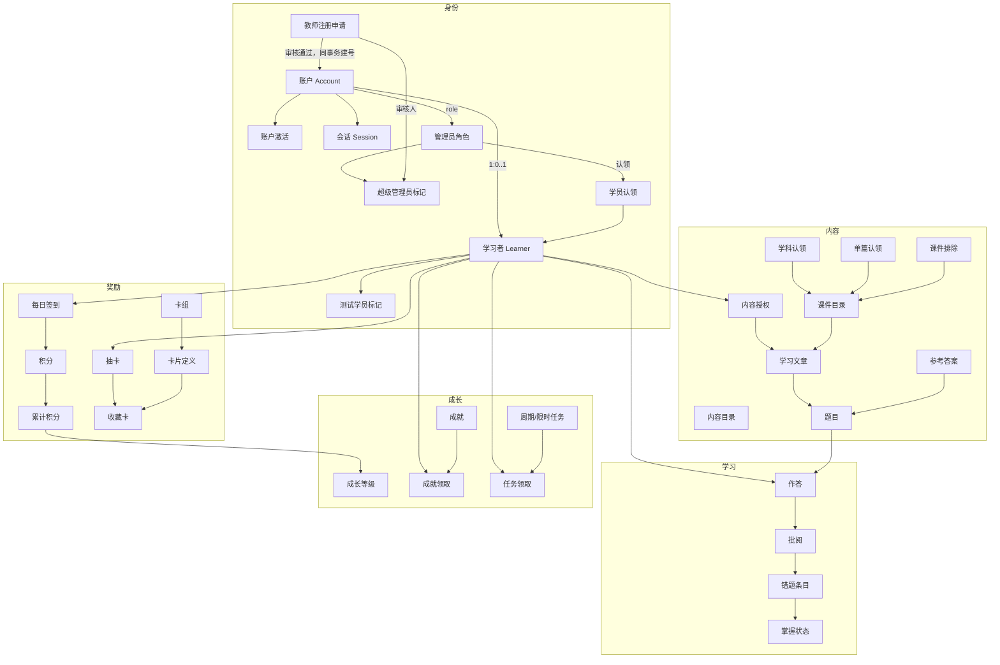
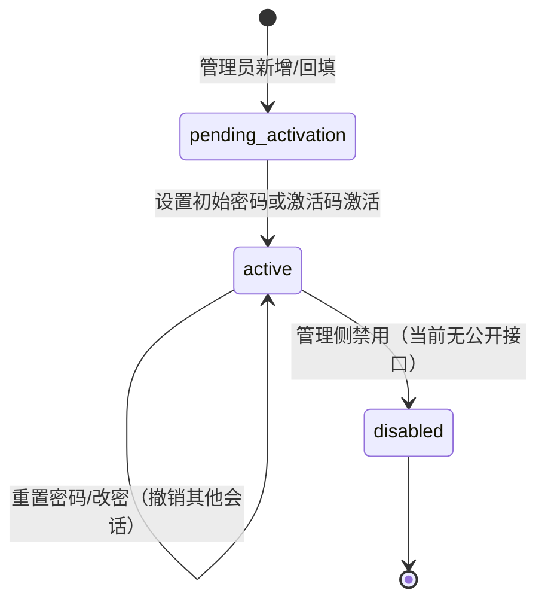
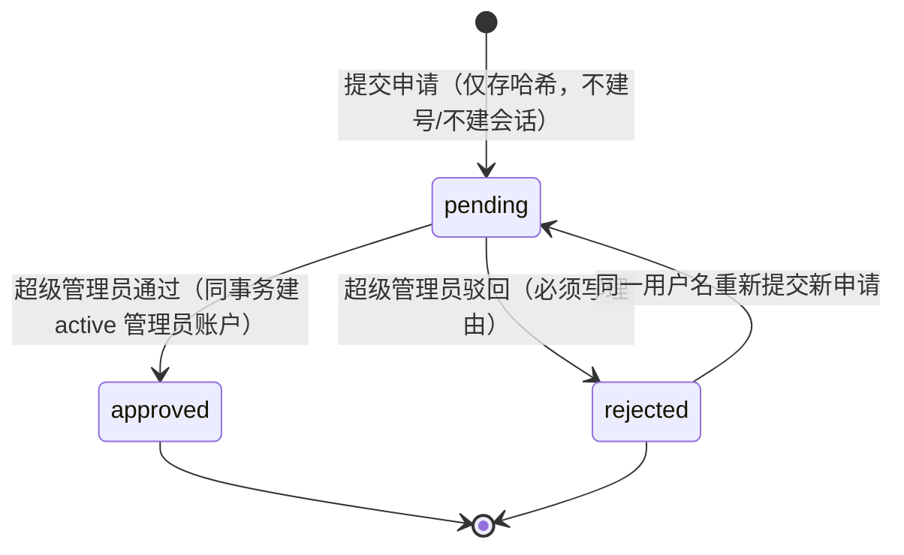
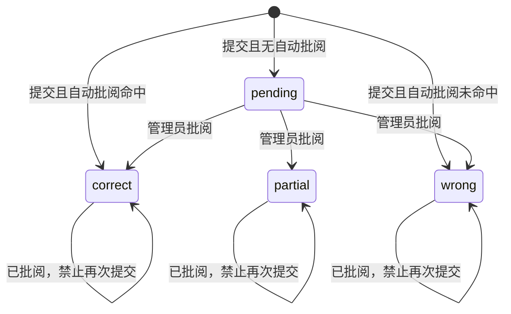
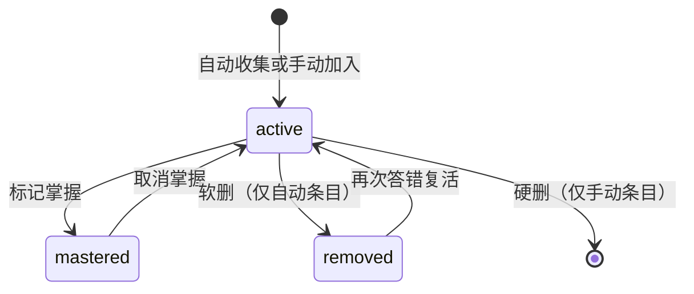

# NEST · 学巢 — 业务对象清单

| 项 | 内容 |
| --- | --- |
| 文档版本 | 1.3 |
| 更新日期 | 2026-10-31 |
| 数据库基线 | Flyway `V1`–`V18` + 存量库 reconciliation（截至 `2026-10-31_*`） |
| 词汇来源 | [`CONTEXT.md`](../CONTEXT.md)；本文只解释对象，不另造概念 |
| 接口来源 | [`backend/api/openapi.yaml`](../backend/api/openapi.yaml)、[`api-standards.md`](api-standards.md) |
| 用途 | 需求评审、接口设计、数据治理、排障时统一"这个词到底指什么、存在哪个表、由谁负责" |

> **阅读提示**：一个"业务对象"不一定等于一张表。授权、认领、掌握、等级等概念可能落在数组列、派生查询或目录代码里；本文逐项标明"持久化形态"，避免把实现细节误当领域概念。

---

## 1. 对象分类总览

| 分类 | 对象 | 数量 |
| --- | --- | --- |
| 身份与访问 | 账户、账户激活、会话、学习者、管理员、学员认领、学员动态、测试学员、教师注册申请、超级管理员 | 10 |
| 内容与归属 | 学习文章、内容目录、题目与题目标识、参考答案、内容授权、科目归属、课件与课件目录、学科/单篇认领、课件排除 | 9 |
| 学习与复习 | 作答、批阅、错题条目、掌握状态、学习进度 | 5 |
| 任务与奖励 | 每日签到、积分余额、累计积分、卡组、卡片定义、卡池、抽卡、收藏卡、当期 UP | 9 |
| 成长 | 成长等级、成就、成就等级、成就领取、周期任务、限时任务、接取、领取、任务领取记录 | 9 |
| 平台 | 系统状态、结构迁移、运行角色 | 3 |
| **合计** | | **45** |

### 1.1 对象关系图



---

## 2. 身份与访问

### BO-IDN-01 账户 Account

- **定义**：可被认证的平台身份，有明确状态与角色。账户不等同于学习者；独立管理员账户可以没有学习者身份。
- **标识**：`account.id`；登录标识是 `username_normalized`（`lower(btrim(username))`）唯一。
- **持久化**：`public.account`。

| 属性 | 列/类型 | 说明 |
| --- | --- | --- |
| 学习者关联 | `learner_id bigint UNIQUE`，FK → `student` `ON DELETE RESTRICT` | 管理员可为空；一个学习者至多一个账户 |
| 用户名 | `username text` + `username_normalized text` | 去空格校验；比较大小写不敏感 |
| 密码摘要 | `password_hash text NULL` | Argon2id；待激活时为空 |
| 状态 | `status text` | `pending_activation` / `active` / `disabled` |
| 角色 | `role text` | `learner` / `administrator` |
| 时间 | `created_at` / `activated_at` | 激活时间仅 `active` 有值 |

- **状态机**



- **不变量**：`username` 必须已 trim；`username_normalized = lower(btrim(username))`；`active` 必须有密码与激活时间，`pending_activation` 两者必须为空；角色只有两种。
- **关系**：1 账户 → 0..1 学习者；1 账户 → N 会话；1 账户 → N 激活码；管理员可认领多个学员、多个学科/课件。
- **主要接口**：`POST /sessions`、`GET /session`、`PUT /password`、`POST /accounts`、`PUT /admin/learners/{id}/password`、`POST /admin/learners/{id}/impersonate`。
- **前端映射**：`stores/authStore.js`、`gateways/identityGateway.js`。

**避免叫法**：用户、student 记录、登录账号。统一说"账户"。

### BO-IDN-02 账户激活 Account Activation

- **定义**：通过可信线下渠道交给账户持有人的一次性短期凭据，用于把 `pending_activation` 账户转为可登录账户。
- **标识**：`account_activation.id`；凭据以 `token_hash` 唯一。
- **持久化**：`public.account_activation`。

| 属性 | 列/类型 | 说明 |
| --- | --- | --- |
| 所属账户 | `account_id` | 级联删除 |
| 摘要 | `token_hash bytea UNIQUE` | 只存 SHA-256，不存明文 |
| 有效期 | `expires_at > created_at` | 一次性、短期 |
| 终态 | `consumed_at` / `revoked_at` | 二者不可同时非空 |
| 签发人 | `created_by` | 管理员账户，账户删除时置空 |

- **不变量**：同一账户最多一条"未消费且未撤销"的激活码（部分唯一索引）；已激活账户不再需要激活码。
- **状态**：`live` → `consumed` 或 `revoked`。
- **接口**：`POST /account-activations/complete`（消费）、`POST /admin/account-activations`（签发，兼容保留）。
- **备注**：当前前端主流程是"管理员直接设密码"，激活码不作为默认入口。

### BO-IDN-03 会话 Session

- **定义**：账户认证后建立的可过期、可撤销浏览器访问上下文；不是账户本身，也不是前端保存的用户名。
- **标识**：`account_session.id`；Cookie 值对应 `token_hash`。
- **持久化**：`public.account_session`。

| 属性 | 说明 |
| --- | --- |
| `token_hash bytea UNIQUE` | 只存摘要 |
| `account_id` | 账户删除时级联删除 |
| `expires_at` | 过期即失效 |
| `authenticated_at` | 登录/进入学员账号时间，用于"学员最近动态" |
| `revoked_at` | 主动登出或重置密码时撤销 |

- **规则**：登录、注册、进入学员账号都轮换 session ID；换密撤销除当前外的会话；管理员重置学员密码撤销其全部会话。
- **接口**：`POST /sessions`、`GET/DELETE /session`、`POST /admin/learners/{id}/impersonate`。
- **不变量**：Cookie `HttpOnly; Secure; SameSite=Lax`，前端不可读；会话表只存摘要。

### BO-IDN-04 学习者 Learner

- **定义**：使用学习内容并提交答案的主体；是内容授权、作答、错题、积分、签到、卡片、任务的归属者。
- **标识**：`student.id`（`learnerId`）；业务内以学习者 ID 引用。
- **持久化**：`public.student`（历史表名保留 `student`，但领域词是 Learner）。

| 属性 | 列/类型 | 说明 |
| --- | --- | --- |
| 用户名 | `username text UNIQUE` | 与账户同步；历史兼容 |
| 内容授权 | `permissions integer[] NOT NULL DEFAULT '{}'` | 文章 ID 白名单 |
| 科目归属 | `subjects text[] NOT NULL DEFAULT '{}'` | 已开通科目，与文章授权独立 |
| 认领 | `claimed_by bigint NULL` / `claimed_at` | 二者必须同时存在或同时为空 |
| 测试标记 | `is_test boolean` / `is_special_test boolean` | 特殊测试必须是测试 |

- **不变量**：`permissions` 与 `subjects` 不为 NULL；科目元素非空字符串；认领状态成对；`is_special_test` ⇒ `is_test`。
- **关系**：1 学习者 ← 0..1 账户；N 学习者 ← 1 管理员（认领）；N 学习者 → N 文章（授权）；N 学习者 → N 科目（归属）；1 学习者 → N 作答/错题/签到/收藏/领取。
- **接口**：`GET /admin/learners`、`POST /admin/learners`、`DELETE /admin/learners/{id}`、`GET /me/content-grants`。
- **前端映射**：`stores/adminStore.js`、`utils/adminStudents.js`、`utils/adminSubjects.js`。

**避免叫法**：学生用户、普通用户、学生表。统一说"学习者/学员"。

### BO-IDN-05 管理员 Administrator

- **定义**：`role=administrator` 的账户，可管理学员、内容授权、参考答案、批阅与课件认领；其中 `is_super_admin=true` 的管理员额外拥有教师注册审核权。
- **标识**：账户的 `role` 列，不是独立表、不是用户名字符串；超级管理员再加 `account.is_super_admin` 布尔标记。
- **规则**：管理员权限由服务端会话角色判定；超级管理员权限由标记判定，**运行时代码不按用户名授权**。V17 迁移只把既有 `young` 标记为超级管理员，之后以数据库标记为准。
- **关系**：管理员 → N 学员认领；管理员 → N 学科认领/单篇认领/排除；超级管理员 → N 教师注册申请（作为审核人）。
- **接口**：所有 `/admin/**`；越权返回 `403 forbidden` 或 `403 courseware_not_claimed`；审核接口还需 `ROLE_SUPER_ADMIN`。

### BO-IDN-06 学员认领 Learner Claim

- **定义**：一名管理员对某个学习者建立的归属关系；一个学习者至多被一名管理员认领；创建学习者的管理员自动认领。
- **标识**：`student.claimed_by` + `claimed_at`（复合状态，不是独立表）。
- **规则**：认领只表达组织归属，不改变科目归属、内容授权、批阅权限或学员可见范围。
- **规则**：查看学员详情、设置/重置密码、进入账号、删除学员都要求当前管理员是该学员的认领人；未认领或他人认领返回 `403 learner_not_claimed`。
- **不变量**：`claimed_by` 与 `claimed_at` 成对；账户删除时 `claimed_by` 置空并由触发器清空 `claimed_at`。
- **接口**：`PUT/DELETE /admin/learners/{id}/claim`。
- **状态**：`未认领` ⇄ `已认领`；重复认领幂等；被他人认领时 `409 learner_already_claimed`。

### BO-IDN-07 学员动态 Learner Activity

- **定义**：学习者在保存作答、整理错题、签到或建立登录会话时产生的最近时间点，用于排序与活跃判断；不代表在线状态。
- **标识**：派生值 `last_activity_at`，无独立表。
- **计算**：`GREATEST(max(作答.updated_at), max(错题.updated_at), max(签到.created_at), max(会话.authenticated_at))`。
- **规则**：由服务端聚合；客户端不得提交；测试学员不进入统计口径。
- **接口**：`GET /admin/learners`、`GET /admin/analytics/overview`、`GET /admin/learners/{id}/profile`。

### BO-IDN-08 测试学员 Test Learner / 特殊测试学员 Special Test Learner

- **定义**：`is_test=true` 的验收/演示账户，保留正常学习能力但不参与统计；`is_special_test=true` 是全局唯一、拥有全课件与固定高积分的特殊账户。
- **标识**：`student.is_test`、`student.is_special_test`；特殊标记有部分唯一索引。
- **规则**：管理端新增入口固定创建测试学员；特殊测试学员 `permissions` 由课件目录补齐；`/rewards` 固定 `999999999` 且抽卡不扣；`/me/content-grants` 返回 `allArticles=true`。
- **规则**：特殊测试学员受删除保护，管理端不显示删除按钮，接口返回 `409 special_test_learner_protected`。
- **不变量**：`is_special_test ⇒ is_test`；全库最多一个特殊测试学员。
- **接口**：`GET /admin/learners`（标记）、`POST /admin/learners`（新增，固定 `is_test=true`）、`GET /rewards`、`GET /me/content-grants`。
- **数据治理**：不得作为真实学员统计或计费对象；回填逻辑（除 `pyt`、`Mel.` 外全部标测试）属于历史数据决策，已写入 migration，不在运行时重复执行。

### BO-IDN-09 教师注册申请 Teacher Registration Application

- **定义**：游客提交的"我想成为教师"申请；它只是待审核意图，不是账户、不是会话，也不代表已获得任何管理员权限。
- **标识**：`teacher_registration_application.id`（bigint identity）；用户名归一化后为 `username_normalized`。
- **持久化形态**：表 `teacher_registration_application`，列 `username`、`username_normalized`、`password_hash`、`status`、`rejection_reason`、`reviewed_by`、`reviewed_at`、`approved_account_id`、`created_at`。
- **状态机**：



- **状态与字段约束**：`pending` 不允许审核人/审核时间/理由/通过账户；`approved` 必须有 `reviewed_at` 与 `approved_account_id`；`rejected` 必须有 `reviewed_at` 与非空 `rejection_reason`、且无通过账户。
- **不变量**：`username = btrim(username)`、`username_normalized = lower(btrim(username))`；同一用户名同时最多一条 `pending`（部分唯一索引）；`approved/rejected` 为终态，不可重复审核；密码只存 Argon2id 哈希。
- **关系**：`reviewed_by → account.id`（审核人，删除置空）；`approved_account_id → account.id`（通过后创建的管理员账户，`ON DELETE RESTRICT` 以保留审核链）；通过后与账户一对一。
- **接口**：`POST /teacher-applications`（公开提交）；`GET /admin/teacher-applications`、`POST /admin/teacher-applications/{id}/approve`、`POST /admin/teacher-applications/{id}/reject`（仅超级管理员）。
- **前端映射**：`HomeView` 注册模式勾选"我是教师" → `authStore.submitTeacherApplication` → `identityGateway.submitTeacherApplication`；管理端 `AdminTeacherApplicationsView` → `teacherApplicationGateway`。
- **避免叫法**：注册记录、待办账号、临时账户、"已经注册成功的教师"。

### BO-IDN-10 超级管理员 Super Administrator

- **定义**：持有审核权限的管理员标记；是 `administrator` 的子集，不是第四种账户角色，也不改变管理员的其他权限边界。
- **标识**：`account.is_super_admin boolean NOT NULL DEFAULT false`，并由 `CHECK (NOT is_super_admin OR role='administrator')` 约束。
- **持久化形态**：`account` 上的布尔列，不是独立表、不是用户名规则；V17 迁移把既有 `young` 置为 `true`。
- **权限**：管理员全部权限 + 查看/通过/驳回教师注册申请；会话投影返回 `superAdmin`，后端授予 `ROLE_SUPER_ADMIN`（同时保留 `ROLE_ADMINISTRATOR`）。
- **不变量**：只有 `administrator` 可以持有该标记；普通接口不能自助设置；零个或多个标记在数据库层允许，但审计脚本会报告"多超级管理员"，运维需人工确认。
- **接口**：`GET/POST /admin/teacher-applications*`；普通管理员访问返回 `403 forbidden`。
- **前端映射**：`authStore.isSuperAdministrator` 控制 `/admin/applications` 路由与导航项；普通管理员被重定向回工作台。
- **避免叫法**：超级用户、root、特殊用户名、第二套角色体系。

---

## 3. 内容与归属

### BO-CNT-01 学习文章 Learning Article

- **定义**：一份拥有稳定身份的学习内容，可包含零道或多道题目；标题和文件路径不是身份。
- **标识**：`articleId`（整数，来自 `public/data/id_map.json`，只增不减）。
- **持久化**：正文与索引是静态文件：`tutor-nest-vue/public/articles/**/*.md`、`public/data/articles.json`、`public/data/id_map.json`。
- **属性**：`id`、`title`（文件名）、`series`（顶层学科目录）、`date`（文件 mtime 或沿用旧值）、`path`。
- **规则**：`npm run dev` / `build` 前的 `sync-articles-data.js` 扫描 Markdown 并分配 ID；已有文件保留 ID，新文件 `maxId+1`。
- **关系**：N 文章 → 1 学科；1 文章 → N 题目/参考答案/作答；文章可被内容授权、课件目录、认领、排除引用。
- **接口**：`GET /articles`（在学习/管理上下文）、`GET /articles/{id}/study-state`、`GET /admin/articles/*`。
- **前端映射**：`stores/blogStore.js`、`views/ArticleDetailView.vue`。

**避免叫法**：博客、blog、静态文件、文档。统一说"学习文章/文章"，管理语境下可说"课件"。

### BO-CNT-02 内容目录 Content Catalog

- **定义**：平台当前可用学习文章及其稳定身份的集合，是导航与授权的共同底座。
- **标识**：`articles.json` 整体；条目以 `articleId` 唯一。
- **持久化**：静态 JSON，构建时生成；不存数据库。
- **规则**：排序 = `series`（`zh-CN`）后按 `id` 升序；前端用 `BASE_URL` 拼接，兼容子路径部署。
- **关系**：驱动学科卡片、文章树、授权勾选、课件目录同步。

### BO-CNT-03 题目 Question 与题目标识 Question Key

- **定义**：文章中可作答的内容；由"文章身份 + 题目标识"唯一定位。
- **标识**：`questionKey` 是**字符串**，不保证整数；前端按占位符规则解析。
- **持久化**：不单独建表；题目存在性由文章正文占位符与参考答案/作答行共同体现。
- **占位符规则**：

| 语法 | 含义 | 渲染 |
| --- | --- | --- |
| `【@】` | 自动编号答题位 | 按出现顺序分配未被占用的编号 |
| `【@N】` | 显式编号答题位（推荐） | 固定 `questionKey = "N"` |
| `【题干N】` | 第 N 题题干片段 | 渲染时隐藏，供错题本拼接 |
| `【题干N-M】` | 第 N–M 题公共题干 | 区间内每题都包含该片段 |

- **规则**：题干优先取 `【题干】` 片段并按出现顺序拼接（截断 400 字）；无标记时启发式取答题位上方紧邻文本；再退化为"最近一级标题 · 第 N 题"。
- **不变量**：`questionKey` 一经使用不应修改，否则历史作答与错题会错位；新增题使用未用编号。
- **接口**：`PUT /articles/{id}/submissions/{questionKey}`、`PUT /admin/articles/{id}/answer-keys`。

### BO-CNT-04 参考答案 Answer Key

- **定义**：管理员为一道题维护的标准答案及自动批阅规则。
- **标识**：`(blog_id, question_id)` 唯一。
- **持久化**：`public.article_answer_keys`。

| 属性 | 列 | 说明 |
| --- | --- | --- |
| 文章 | `blog_id bigint` | 历史列名，语义为 `articleId` |
| 题目 | `question_id text` | 即 `questionKey` |
| 答案 | `answer_text text NOT NULL DEFAULT ''` | 空答案视为未设置 |
| 自动批阅 | `auto_grade boolean` | 仅当答案非空才生效 |
| 时间 | `created_at` / `updated_at` | `updated_at` 由触发器维护 |

- **规则**：整组 PUT 替换该文章答案集合；自动批阅只做换行归一后的完全匹配。
- **可见性**：学习者仅在该题 `reviewed` 后可见；管理员在"我的课件"内可见。
- **接口**：`GET/PUT /admin/articles/{id}/answer-keys`、`GET /admin/articles/answer-key-article-ids`。

### BO-CNT-05 内容授权 Content Grant

- **定义**：允许某个学习者访问一篇学习文章的明确关系；管理员不需要逐篇授权自己。
- **标识**：`(learnerId, articleId)`，落库为数组元素。
- **持久化**：`student.permissions integer[]`；特殊测试学员由 `is_special_test` 全量放行。
- **规则**：授权控制导航与学习数据（作答、进度、批阅），**不保证正文 URL 保密**；管理员替换授权只作用于"我的课件"范围，范围外保留。
- **接口**：`GET /me/content-grants`、`PUT /admin/learners/{id}/content-grants`。
- **前端映射**：`gateways/learnerGateway.js`、`stores/authStore.js`、`utils/adminSubjects.js`。

**避免叫法**：permissions 数组、文章权限值、角色。统一说"内容授权"。

### BO-CNT-08 科目归属 Subject Enrollment

- **定义**：管理员为某个学习者开通的学习科目。它回答"这个学员学哪几科"，不回答"能看哪几篇文章"。
- **标识**：`(learnerId, subject)`，落库为 `student.subjects text[]` 的数组元素。
- **持久化**：`public.student.subjects`（V18 新增，非空、无空字符串约束）。
- **规则**：开通科目只写科目归属，**初始不授权该科目下任何文章**；文章授权由 `student.permissions` 独立维护。取消科目会同步移除该科已授权文章（由前端一次提交 `articleIds + enrolledSubjects` 完成）。科目必须属于当前管理员"我的课件"范围，否则 `403 courseware_not_claimed`。
- **不变量**：`subjects` 不为 NULL；元素去空格后非空且不重复；科目归属与文章授权互不推导。
- **接口**：`PUT /admin/learners/{id}/content-grants`；列表响应字段 `enrolledSubjects`。
- **前端映射**：`utils/adminSubjects.js`、`components/admin/LearnerSubjectPanel.vue`、`components/admin/PermissionPanel.vue`、`stores/adminStore.js`。
- **迁移**：V18 从既有 `permissions × courseware_catalog` 反推科目，仅回填 `subjects` 为空且能推导出非空集合的学员。

### BO-CNT-06 课件 Courseware 与课件目录 Courseware Catalog

- **定义**：管理员视角下按学科组织、需要维护参考答案与批阅的学习文章；同一篇文章对学员是学习内容，对管理员是可认领的课件。课件目录是"课件身份 → 学科/标题"的映射。
- **标识**：`courseware_catalog.article_id`（主键）。
- **持久化**：`public.courseware_catalog`。

| 属性 | 列 | 说明 |
| --- | --- | --- |
| 文章 | `article_id bigint PK` | 来自 `articles.json` |
| 学科 | `subject text` | 顶层目录名，如 化学/英语/初中英语 |
| 标题 | `title text NULL` | 便于管理端展示 |
| 同步 | `updated_at` | 幂等 upsert |

- **规则**：目录由前端同步（`POST /admin/courseware-catalog/sync`）；它不是文章本身，正文仍在静态文件。
- **关系**：1 学科 → N 课件；课件被学科认领覆盖、单篇认领、排除引用。

### BO-CNT-07 学科认领 Subject Claim 与单篇认领 Courseware Claim

- **定义**：管理员对某学科或某篇课件建立的维护归属。认领学科覆盖该学科当前及未来全部课件；学科与管理员多对多，单篇也可被多名管理员认领。
- **标识**：`(admin_account_id, subject)` 与 `(admin_account_id, article_id)` 分别唯一。
- **持久化**：`public.admin_subject_claim`、`public.admin_courseware_claim`。

| 对象 | 关键列 | 说明 |
| --- | --- | --- |
| 学科认领 | `admin_account_id`、`subject`、`claimed_at` | 不物化每篇归属，因此自动覆盖新增课件 |
| 单篇认领 | `admin_account_id`、`article_id`、`claimed_at` | 独立于学科认领，释放学科后仍保留 |

- **"我的课件"公式**：

```text
mine(admin) = { a | a.subject ∈ claimedSubjects(admin) ∧ a ∉ excluded(admin) }
            ∪ { a | (admin, a) ∈ singleClaims }
```

- **规则**：认领/释放学科时清理该科排除；单篇认领时清除排除；重复操作幂等。
- **接口**：`PUT/DELETE /admin/courseware-claims/subjects/{subject}`、`PUT/DELETE /admin/courseware-claims/articles/{articleId}`、`GET /admin/courseware-claims`。

**避免叫法**：课件所有权、独占认领、锁定学科。统一说"认领"。

### BO-CNT-08 课件排除 Courseware Exclusion

- **定义**：管理员对"本已被自己学科认领覆盖"的某篇课件做的单独释放标记；排除后该课件从"我的课件"和业务页消失，回到待认领，重新认领可恢复。
- **标识**：`(admin_account_id, article_id)` 唯一。
- **持久化**：`public.admin_courseware_exclusion`。
- **规则**：只对学科覆盖有意义；释放学科时清理该科排除；排除不等于删除课件、不等于取消学科、不等于隐藏文章。
- **接口**：随单篇释放/认领隐式写入/删除；`GET /admin/courseware-claims/catalog?scope=unclaimed` 返回 `excluded=true`。

---

## 4. 学习与复习

### BO-LRN-01 作答 Submission

- **定义**：学习者对一道题当前保存的答案；再次提交会更新当前作答，不代表完整作答历史。
- **标识**：`(blog_id, student_id, question_id)` 唯一，`id` 为行主键。
- **持久化**：`public.article_question_submissions`。

| 属性 | 列 | 说明 |
| --- | --- | --- |
| 文章 | `blog_id` | `articleId` |
| 学习者 | `student_id` | 外键级联删除 |
| 题目 | `question_id text` | `questionKey` |
| 答案 | `answer_text text NOT NULL DEFAULT ''` | 原文保存，不 trim、不改写 |
| 批阅状态 | `review_status` | `pending` / `reviewed` |
| 批阅结果 | `review_result` | `correct` / `partial` / `wrong`，pending 时为空 |
| 时间 | `submitted_at` / `reviewed_at` / `updated_at` | 更新由触发器维护 |

- **不变量**：`pending` ⇒ 无结果、无 `reviewed_at`；`reviewed` ⇒ 两者齐备；已批阅不可再提交。
- **规则**：保存作答需已授权文章；自动批阅与错题收集在同一事务。
- **接口**：`PUT /articles/{id}/submissions/{questionKey}`、`GET /articles/{id}/study-state`、`GET /admin/articles/{id}/study-state`。
- **前端映射**：`gateways/learningGateway.js`、`ArticleDetailView`。

**避免叫法**：尝试、答题记录历史、提交记录表。统一说"作答"。

### BO-LRN-02 批阅 Review

- **定义**：对一份作答给出的审核状态和结果，可由规则自动产生或由管理员给出。
- **标识**：不独立成行，落在 `article_question_submissions.review_status/review_result/reviewed_at`。
- **规则**：结果三档 `correct` / `partial` / `wrong`；自动批阅只会产生 `correct` 或 `wrong`；人工批阅不修改学员答案；`wrong` 触发错题收集。
- **状态机**



**避免叫法**：改答案、订正。统一说"批阅"。

### BO-LRN-03 错题条目 Wrong Question Entry

- **定义**：学习者针对一道来源题目的复习记录，保留最近答案、出错次数、错因、笔记和掌握状态；手动加入与自动收集是两种来源。
- **标识**：`wrong_questions.id`；来源唯一键 `(student_id, source_blog_id, source_question_id)`。
- **持久化**：`public.wrong_questions`。

| 属性 | 列 | 说明 |
| --- | --- | --- |
| 归属 | `student_id` | 外键级联删除 |
| 来源 | `source_blog_id` / `source_question_id` | 可为空（纯手动条目） |
| 答案 | `correct_answer` / `my_answer` | 最近一次判错时写入 |
| 复习 | `wrong_reason` / `note` / `tags text[]` | 学员可编辑 |
| 次数 | `wrong_count >= 1` | 每次新的 `wrong` +1，不清零 |
| 状态 | `is_manual` / `mastered` / `removed` | 手动/自动来源、掌握、软删 |

- **状态机**



- **规则**：答错时 upsert 并 `removed=false`；手动收集已存在未移除条目返回冲突；标准答案仅在来源作答已批阅时可见。
- **已知缺口**：`PATCH /wrong-book/entries/{id}` 只接受 `myAnswer/wrongReason/tags/note/mastered`，不接受 `wrong_count`。错题训练页答错时前端只在本地 +1，刷新后回退；服务端次数仅在作答/批阅判 `wrong` 时累加。
- **接口**：`GET /wrong-book`、`POST /wrong-book/entries`、`PATCH/DELETE /wrong-book/entries/{id}`。
- **前端映射**：`stores/wrongQuestionsStore.js`、`gateways/wrongBookGateway.js`、`WrongTrainingView.vue`。

**避免叫法**：错题本题目副本、错题收藏。统一说"错题条目"。

### BO-LRN-04 掌握状态 Mastery

- **定义**：学习者对一个错题条目是否已掌握的显式判断；它不删除条目，也不清零出错次数。
- **标识**：`wrong_questions.mastered`。
- **规则**：可与 `active/removed` 状态正交；掌握后仍可取消；成就有"掌握错题数"指标。

### BO-LRN-05 学习进度 Study Progress

- **定义**：学习者在已授权文章上的作答与批阅完成情况，用于提醒、统计与"完成文章数"指标。
- **标识**：派生值，无独立表。
- **计算**：按文章聚合该学习者的作答；"完成"通常指该文章全部有答案的题目均有提交；成就 `reading` 使用"提交数 ≥ 答案键数"的文章数。
- **接口**：`GET /articles/study-progress`、`GET /admin/learners/{id}/study-progress`、`GET /admin/learners/{id}/profile`。

---

## 5. 任务与奖励

### BO-RWD-01 每日签到 Daily Check-in

- **定义**：学习者在一个自然日内至多完成一次的参与记录；自然日按平台约定时区（Asia/Shanghai）判定。
- **标识**：`(student_id, check_in_date)` 唯一。
- **持久化**：`public.daily_check_in`。

| 属性 | 列 | 说明 |
| --- | --- | --- |
| 学习者 | `student_id` | 级联删除 |
| 日期 | `check_in_date date` | 服务端按 Asia/Shanghai 生成 |
| 发放 | `points_awarded > 0` | 100 或 200 |
| 里程碑 | `bonus_days` | `7` / `14` 时额外 +100 |
| 时间 | `created_at` | 用于最近动态 |

- **规则**：同日重复调用幂等返回 `alreadyCheckedIn`；第 7、14 次按**当月**计数。
- **接口**：`GET /checkins?year=&month=`、`POST /checkins`。
- **前端映射**：`stores/checkinStore.js`、`gateways/checkinGateway.js`。

### BO-RWD-02 积分余额 Points Balance

- **定义**：学习者从受信任奖励规则累计得到、尚未消费的当前可用积分；抽卡会消耗它。客户端展示值不是事实来源。
- **标识**：`user_points.student_id`（主键，即学习者）。
- **持久化**：`public.user_points.points bigint CHECK >= 0`。
- **规则**：签到、成就、任务在事务内累加；抽卡扣减；不得由客户端直接写。
- **接口**：`GET /rewards`、`GET /tasks/board`、`GET /checkins`。

### BO-RWD-03 累计积分 Lifetime Points

- **定义**：学习者历史上累计获得的积分总额，只增不减；等级与成长阶段以它为准，不受抽卡消费影响。
- **标识**：`user_points.lifetime_points bigint`。
- **规则**：V8 回填 `GREATEST(lifetime_points, points)`；此后只随奖励增加。
- **派生**：成长等级 = `floor(lifetime_points / 200) + 1`。

### BO-RWD-04 卡组 Card Set

- **定义**：一组主题化卡片的集合定义（名称、主题、风格、徽记、配色、排序、启用状态）。
- **标识**：`card_sets.set_key` 主键。
- **持久化**：`public.card_sets`。
- **属性**：`set_key`、`name`、`theme`、`style`、`emblem`、`color_a`、`color_b`、`sort_order`、`active`。
- **规则**：新增卡组只需插入数据行；启用顺序决定 UP 轮换。

### BO-RWD-05 卡片定义 Card Definition

- **定义**：卡池中的一张卡：所属卡组、名称、图片路径、稀有度、排序与启用状态。
- **标识**：`card_definitions.card_key` 主键。
- **持久化**：`public.card_definitions`。
- **不变量**：`rarity ∈ {common, rare}`；每个卡组最多一张启用稀有卡（部分唯一索引）。
- **资产**：图片位于 `public/cards/{card_key}.png`。

### BO-RWD-06 卡池 Card Pool

- **定义**：由服务端数据库维护的一组启用卡组与卡片定义；每张卡有稀有度、图片路径和所属卡组。
- **标识**：派生集合（`active` 的 `card_sets` + `card_definitions`）。
- **规则**：数量不写死；目录接口每次读取 active 行；成就"收藏家"档位随卡池总量缩放。

### BO-RWD-07 抽卡 Draw

- **定义**：学习者消耗积分从卡池中随机获得收藏卡的动作；稀有度、当期 UP 和具体卡片全部由服务端决定。
- **标识**：一次请求 `POST /rewards/draws {count}`，结果为一组收藏卡 + 计数变化。
- **规则**：每张 80 积分；稀有 5%；命中稀有后 50% 为当期 UP；`count` 1–10；扣分、写收藏、`draw_count` 累加同一事务；积分不足 `409 insufficient_points`。
- **不变量**：客户端不得提交 `studentId`、`cardKey`、`setKey`、`rarity`、`isUp`。
- **接口**：`POST /rewards/draws`、`GET /rewards/catalog`。

### BO-RWD-08 收藏卡 Collection Card

- **定义**：抽卡产生的一项持久收藏；同一学习者可重复获得同一张卡，统计区分总数与不重复数。
- **标识**：`card_collection.id`；业务唯一性由 `(student_id, card_key, claimed_at)` 语义表达，不做去重约束。
- **持久化**：`public.card_collection`。

| 属性 | 列 | 说明 |
| --- | --- | --- |
| 学习者 | `student_id` | 级联删除 |
| 卡片 | `card_key` / `set_key` / `rarity` | 冗余便于展示与统计 |
| 获得时间 | `claimed_at` | 用于最近掉落展示 |

- **统计**：总数 = `COUNT(*)`；不重复 = `COUNT(DISTINCT card_key)`；累计抽卡 = `user_points.draw_count`。
- **历史变更**：V9 删除 `milestone_points`，收藏不再绑定积分里程碑。

### BO-RWD-09 当期 UP Weekly UP Card

- **定义**：按 ISO 周轮换的一张稀有卡；抽到稀有卡时更可能命中它，轮换以下周一 00:00（Asia/Shanghai）为准。
- **标识**：派生值 `upCard(isoWeek)`。
- **规则**：UP 卡组下标 = `floorMod(isoWeek - 1, 启用卡组数)`；命中概率 50%；下一期生效时间 = 下周一 00:00。
- **不变量**：轮换确定性，不依赖客户端时间或随机种子。

---

## 6. 成长

### BO-GRW-01 成长等级 Growth Level

- **定义**：由服务端累计积分推导的学习阶段，每 200 积分提升一级；等级本身不再直接发放积分。
- **标识**：派生值 `level = floor(lifetime_points / 200) + 1`。
- **展示**：7 个段位（学海新芽 / 拾光学徒 / 解题行者 / 知识领航 / 思维舵手 / 星轨学者 / 传奇学人），前端 `utils/level.js` 只做展示。
- **不变量**：等级只读累计积分；抽卡消费不降级；前端不写积分。

### BO-GRW-02 成就 Achievement

- **定义**：一组按指标累积提升等级的学习里程碑；每个等级只可领取一次积分奖励。
- **标识**：`achievement_key`（代码目录，非表）。
- **目录（7 项）**：

| key | 标题 | 指标 | 档位要求（第 1→6/7 档） |
| --- | --- | --- | --- |
| `checkin` | 签到足迹 | 累计签到 | 1/3/7/14/30/60/100 |
| `submission` | 提笔作答 | 累计提交 | 1/5/15/30/60/120 |
| `mastery` | 温故知新 | 累计掌握 | 1/3/5/10/20/40 |
| `collection` | 错题收藏家 | 累计收集 | 1/5/10/20/40/80 |
| `reading` | 博览群书 | 完成文章数 | 1/3/5/10/20/40 |
| `cards` | 收藏家 | 不重复卡数 | 卡池总量 5/15/30/50/75/100% |
| `obtained` | 欧气收集家 | 累计获卡数（含重复） | 1/5/10/25/50/100 |

- **持久化**：目录在 `AchievementCatalog.java`；领取记录在表。
- **接口**：`GET /achievements`、`POST /achievements/{key}/claims`。

### BO-GRW-03 成就等级 Achievement Tier

- **定义**：同一成就内递增的要求与奖励档位，等级越高要求越多；领取记录以学习者、成就和等级唯一确定。
- **标识**：`(achievement_key, tier_level)`。
- **奖励（示例）**：签到 20/30/50/80/120/180/260；提交 20/30/50/80/120/180；掌握 30/40/60/100/160/240；收藏 20/30/50/80/120/180；阅读 20/30/50/80/120/180；卡片 20/30/50/80/120/200；获卡 20/30/50/80/120/180。
- **规则**：只能领取"下一级已达成且未领取"的档位。

### BO-GRW-04 成就领取 Achievement Claim

- **定义**：学习者领取某成就某档奖励的不可重复记录。
- **标识**：`(student_id, achievement_key, tier_level)` 唯一。
- **持久化**：`public.achievement_claims`（`reward_points > 0`，`claimed_at`）。
- **规则**：写入领取记录与积分累加同一事务；重复领取 `409 achievement_already_claimed`。
- **接口**：`POST /achievements/{key}/claims`。

### BO-GRW-05 周期任务 Periodic Task

- **定义**：按自然日或自然周自动刷新的任务；每个周期内只可领取一次奖励，不区分学科。
- **标识**：`task_key` + `period_key`（如 `daily-2026-10-30` / `weekly-2026-W44`）。
- **目录**：每日 `daily-submit`（2 次提交，20 分）、`daily-collect`（1 次收集，20 分）、`daily-master`（1 次掌握，30 分）；每周 `weekly-submit`（8 次提交，80 分）、`weekly-master`（3 次掌握，100 分）、`weekly-checkin`（5 天签到，80 分）。
- **持久化**：目录在 `TaskCatalog.java`；领取记录在 `task_claims`。
- **刷新**：按 Asia/Shanghai 自然日/自然周；周期切换后进度从 0 重新计算。

### BO-GRW-06 限时任务 Limited Task

- **定义**：需要学习者主动接取后才开始计时与统计的任务；截止时间由服务端按宽松窗口生成。
- **目录**：`sprint-submit`（7 天内 6 次提交，120 分）、`sprint-master`（10 天内 2 次掌握，150 分）、`sprint-collect`（7 天内 3 次收集，100 分）。
- **规则**：未接取不计进度；过期 `409 task_expired` 可重新接取；同一接取只能领一次。

### BO-GRW-07 接取 Accept 与领取 Claim（动作）

- **定义**：接取是学习者显式开始限时任务的动作；领取是任务或成就达到条件后由服务端在事务内写入记录并发放积分。
- **标识**：动作本身不建对象；结果分别落 `task_assignments`（接取）与 `task_claims` / `achievement_claims`（领取）。
- **规则**：客户端不得提交奖励积分、截止时间或完成状态。

### BO-GRW-08 任务接取记录 Task Assignment

- **定义**：一次限时任务接取的时间窗记录。
- **标识**：`(student_id, task_key)` 唯一。
- **持久化**：`public.task_assignments`。
- **属性**：`accepted_at`、`deadline_at`（服务端生成）、`claimed_at`（可空）。
- **规则**：重复接取 `409 task_already_accepted`；过期可重新接取（覆盖/新建按实现，语义为"新窗口"）。

### BO-GRW-09 任务领取记录 Task Claim

- **定义**：某周期或某次接取的任务奖励领取记录。
- **标识**：`(student_id, task_key, period_key)` 部分唯一（`task_key` 非空时）。
- **持久化**：`public.task_claims`（兼容历史 `task_id` 可空；`reward_points` 记录发放值）。
- **规则**：写入与积分累加同一事务；重复领取 `409 task_already_claimed`。

**避免叫法**：每日目标、任务点击、里程碑领取。统一说"任务/领取"。

---

## 7. 平台对象

### BO-SYS-01 系统状态 System Status

- **定义**：对外暴露的服务版本与可用性快照。
- **标识**：派生响应，无表。
- **字段**：`status`（当前仅 `ok`）、`service`、`version`（build metadata，未知为 `dev`）、`time`（注入 `Clock`）。
- **规则**：不返回 profile、hostname、JVM 参数、数据库 URL、用户名、环境变量或 secret。

### BO-SYS-02 结构迁移 Flyway Migration

- **定义**：数据库结构的唯一写入来源与版本化历史。
- **标识**：`flyway_schema_history` 的 `version`。
- **规则**：文件名 `V{n}__{lower_snake_case}.sql`；已执行 migration 永不修改；空库与存量库两条路径都要可验证。
- **对象清单**：V1 四张基础表 → V2 约束与触发器 → V3 身份/会话 → V4 签到/积分 → V5 奖励/收藏 → V6 成就/任务 → V7 抽卡收藏 → V8 累计积分 → V9 移除积分里程碑 → V10 卡池目录 → V11 学员认领 → V12 课件认领 → V14 运行角色授权 → V15 课件排除 → V16 测试学员 → V17 教师注册审核与超级管理员（无 V13，Flyway 允许跳号）。

### BO-SYS-03 运行角色 Runtime Role

- **定义**：应用连接数据库使用的受限角色（`tutor_base_runtime`），具备业务表 DML 与 RLS 策略，无 DDL 权限。
- **标识**：数据库角色名。
- **规则**：由 `database/operations/provision_runtime_role.sql` 授权；结构变更由具备 DDL 的账户执行；浏览器角色最终无业务表直写权限。

---

## 8. 对象 → 表 / 接口 / 前端映射总表

| 业务对象 | 持久化 | 主要接口 | 前端 gateway / store |
| --- | --- | --- | --- |
| 账户 | `account` | `/sessions`、`/session`、`/password`、`/accounts` | `identityGateway`、`authStore` |
| 账户激活 | `account_activation` | `/account-activations/complete`、`/admin/account-activations` | （前端未使用） |
| 会话 | `account_session` | 同上 | `authStore` |
| 教师注册申请 | `teacher_registration_application` | `/teacher-applications`、`/admin/teacher-applications*` | `identityGateway`、`teacherApplicationGateway` |
| 超级管理员 | `account.is_super_admin` | `/admin/teacher-applications*` | `authStore`（`isSuperAdministrator`） |
| 学习者 | `student` | `/admin/learners`、`/me/content-grants` | `learnerGateway`、`adminStore` |
| 学员认领 | `student.claimed_by/claimed_at` | `/admin/learners/{id}/claim` | `learnerGateway`、`useAdminWorkspace` |
| 测试学员 | `student.is_test/is_special_test` | `/admin/learners`、`/rewards` | `learnerGateway`、`tasksStore` |
| 学习文章 / 内容目录 | 静态 Markdown + `articles.json` | `/articles/study-progress` | `blogStore` |
| 题目 / 题目标识 | 文章占位符 | `/articles/{id}/submissions/{qk}` | `learningGateway`、`questionText.js` |
| 参考答案 | `article_answer_keys` | `/admin/articles/{id}/answer-keys` | `learningGateway` |
| 内容授权 | `student.permissions` | `/me/content-grants`、`/admin/.../content-grants` | `learnerGateway`、`authStore` |
| 科目归属 | `student.subjects` | `/admin/.../content-grants`、`/admin/learners` | `learnerGateway`、`adminStore`、`adminSubjects.js` |
| 课件目录 | `courseware_catalog` | `/admin/courseware-catalog/sync` | `coursewareStore` |
| 学科/单篇认领 | `admin_subject_claim`、`admin_courseware_claim` | `/admin/courseware-claims*` | `coursewareStore` |
| 课件排除 | `admin_courseware_exclusion` | 同上 | `coursewareStore` |
| 作答 / 批阅 | `article_question_submissions` | `/articles/{id}/submissions/{qk}`、`/admin/.../review` | `learningGateway` |
| 错题条目 / 掌握 | `wrong_questions` | `/wrong-book*` | `wrongBookGateway`、`wrongQuestionsStore` |
| 学习进度 | 派生 | `/articles/study-progress`、`/admin/learners/{id}/study-progress` | `learningGateway`、`analytics.js` |
| 每日签到 | `daily_check_in` | `/checkins` | `checkinGateway`、`checkinStore` |
| 积分 / 累计积分 | `user_points` | `/rewards`、`/checkins`、`/tasks/board` | `tasksStore` |
| 卡组 / 卡片定义 | `card_sets`、`card_definitions` | `/rewards/catalog` | `cardCatalogStore`、`rewardGateway` |
| 抽卡 / 收藏卡 | `card_collection`、`user_points.draw_count` | `/rewards/draws`、`/rewards` | `rewardGateway`、`tasksStore` |
| 成长等级 | 派生 | `/rewards` | `utils/level.js` |
| 成就 / 成就等级 / 领取 | 目录代码 + `achievement_claims` | `/achievements*` | `growthGateway`、`tasksStore` |
| 周期/限时任务 / 接取 / 领取 | 目录代码 + `task_assignments`、`task_claims` | `/tasks/**` | `growthGateway`、`tasksStore` |
| 学员动态 | 派生 | `/admin/learners`、`/admin/analytics/overview` | `learnerGateway`、`analytics.js` |
| 系统状态 | 派生 | `/system/status` | — |
| 结构迁移 / 运行角色 | `flyway_schema_history`、数据库角色 | 部署流程 | — |

---

## 9. 关键不变量清单（评审必查）

| # | 不变量 | 落点 | 违反后果 |
| --- | --- | --- | --- |
| 1 | 一个学习者至多一个账户；一个账户至多一个学习者 | `account.learner_id UNIQUE` | 数据双身份、授权错乱 |
| 2 | 账户状态与密码/激活时间一致 | `account_activation_state_check` | 未激活账户可登录 |
| 3 | 认证会话只存摘要、Cookie 不可读 | `account_session.token_hash` + HttpOnly | 会话泄露 |
| 4 | 认领状态成对 | `student_claim_state_check` + 触发器 | 半认领、取消认领失败 |
| 5 | 特殊测试必须同时是测试，且全局唯一 | CHECK + 部分唯一索引 | 多个"超级学员"、统计污染 |
| 6 | 内容授权不为 NULL | `permissions NOT NULL` | 授权查询空指针 |
| 7 | 参考答案 `(articleId, questionKey)` 唯一 | 唯一约束 | 同题多答案，批阅不确定 |
| 8 | 作答 `(articleId, learnerId, questionKey)` 唯一 | 唯一约束 | 重复作答、统计翻倍 |
| 9 | `pending` 无结果，`reviewed` 结果与时间齐备 | CHECK + 触发器 | 状态含混、UI 误判 |
| 10 | 错题来源 `(learner, article, question)` 唯一 | 唯一约束 | 重复条目、次数分裂 |
| 11 | 错题次数 ≥ 1 | CHECK | 统计负数 |
| 12 | 每日签到 `(learner, date)` 唯一 | 唯一约束 | 重复加分 |
| 13 | 积分余额 ≥ 0 | CHECK | 负积分、抽卡异常 |
| 14 | 每卡组最多一张启用稀有卡 | 部分唯一索引 | UP 轮换不确定 |
| 15 | 成就 `(learner, key, tier)` 唯一 | 唯一约束 | 重复领奖 |
| 16 | 任务 `(learner, key, period)` 唯一 | 部分唯一索引 | 重复领奖 |
| 17 | 认领只覆盖自己的范围，范围外授权保留 | 服务层 + 测试 | 管理员互相覆盖 |
| 18 | 自动批阅与错题收集同事务 | `LearningService` `@Transactional` | 半完成状态 |
| 19 | 领取与积分累加同事务 | `GrowthService` | 领了奖没加分 |
| 20 | 结构只经版本化迁移演进 | Flyway | 环境漂移、无法回滚 |
| 21 | 同一用户名最多一条待审核教师申请 | `teacher_registration_application_pending_username` 部分唯一索引 | 重复审核、重复建号 |
| 22 | 申请状态与审核字段一致；通过必须指向已建账户 | `teacher_registration_application_state_check` | "已通过"却没有管理员、半通过 |
| 23 | 只有管理员可持有超级管理员标记 | `account_super_admin_role_check` | 学习者获得审核权 |
| 24 | 科目归属与文章授权相互独立；开通科目不自动授权文章 | `student.subjects` + 服务层/前端 + 测试 | 科目开通即泄露整科文章 |
| 25 | 特殊测试学员不可删除 | 服务层先于认领校验 | 破坏全链路验收环境 |

---

## 10. 生命周期与删除影响

| 操作 | 直接删除/变更 | 级联影响 | 保护条件 |
| --- | --- | --- | --- |
| 删除学习者 | `student` 行 | 账户（RESTRICT 先删账户）、会话、激活码、作答、错题、签到、积分、收藏、成就/任务领取、任务接取 | 未认领/他人认领 `403 learner_not_claimed` / `409 learner_already_claimed`；特殊测试学员 `409 special_test_learner_protected`；关联管理员账户 `409 administrator_learner_protected` |
| 删除账户 | `account` 行 | 会话、激活码、认领（`SET NULL` + 触发器清时间）、学科/单篇认领、排除；若该账户是某条已通过申请的建号结果，`approved_account_id` 的 RESTRICT 会阻止删除 | 账户仍关联学习者时受 RESTRICT 约束；已通过教师申请的账户需先处理审核链 |
| 删除教师申请 | 当前无删除接口 | 审核记录随之消失，但已建管理员账户不受影响 | 审计要求保留，故不提供删除 |
| 删除学科认领 | `admin_subject_claim` 行 | 该科排除一并清理；单篇认领保留；课件本身不受影响 | — |
| 释放单篇（学科覆盖下） | `admin_courseware_exclusion` 行 | 该课件从"我的课件"消失，回待认领 | 再次认领或重新认领学科可恢复 |
| 删除手动错题 | 硬删除 `wrong_questions` 行 | 无 | — |
| 删除自动错题 | `removed=true` | 再次答错复活 | — |
| 删除文章源文件 | 静态文件 | 索引重算；数据库历史作答/错题仍在（需单独治理） | — |

---

## 11. 术语别名对照（写文档/命名时使用）

| 不要使用 | 应使用 | 原因 |
| --- | --- | --- |
| 用户、student 记录 | 账户 / 学习者 | 账户与学习者不是同一概念 |
| 博客、blog、文档 | 学习文章 | 内容有稳定身份，不是博客 |
| 静态文件、前端写死列表 | 内容目录 / 课件目录 | 目录是有语义的映射 |
| 初始密码、永久邀请码 | 激活码 | 一次性、短期、只存哈希 |
| 超级用户、root、特殊用户名 | 超级管理员 | 审核权来自 `is_super_admin` 标记，不来自用户名 |
| 注册成功、待办账号 | 教师注册申请 | 提交申请不等于建号，审核通过才成为管理员 |
| 分配学生、绑定管理员、学员所有权 | 学员认领 | 认领只表达组织归属 |
| 课件所有权、独占认领、锁定学科 | 学科认领 / 单篇认领 | 多对多、不独占 |
| permissions 数组、文章权限值 | 内容授权 | 数组是存储形式，不是领域词 |
| 课程包、已学科目、整科授权 | 科目归属 | 科目归属不包含文章授权 |
| 尝试、答题历史、提交记录表 | 作答 | 覆盖式当前答案 |
| 改答案、订正 | 批阅 | 批阅不改学员原文 |
| 错题本题目副本 | 错题条目 | 保留来源身份与出错次数 |
| 完成状态 | 掌握状态 | 掌握不等于删除 |
| 每日登录、任务点击 | 每日签到 | 自然日一次 |
| 前端积分、可编辑分数 | 积分余额 | 服务端是事实来源 |
| 当前积分（用于等级） | 累计积分 | 等级按只增不减的累计值 |
| 前端写死卡片列表、按积分档位发卡 | 卡池 / 抽卡 | 服务端目录与概率 |
| 固定稀有卡、手动指定概率 | 当期 UP | 按 ISO 周确定性轮换 |
| 里程碑唯一卡、随机前端图片 | 收藏卡 | 可重复获得，统计区分总数/不重复 |
| 经验值、客户端等级 | 成长等级 | 由累计积分推导 |
| 任务、每日目标 | 成就 | 成就按指标累积分级 |
| 段位、徽章数量 | 成就等级 | 档位要求与奖励递增 |
| 倒计时活动 | 限时任务 | 必须主动接取 |
| 完成、点击按钮 | 领取 | 服务端事务内发奖 |

---

## 12. 变更记录

| 日期 | 版本 | 变更 |
| --- | --- | --- |
| 2026-10-30 | 1.0 | 首次建立业务对象清单：42 个对象、表/接口/前端映射、20 条不变量、删除影响矩阵、术语对照；与 V16 基线对齐 |
| 2026-10-31 | 1.1 | 新增教师注册申请与超级管理员两个对象；补 V17 迁移、审核状态机、3 条不变量与删除影响；对象总数 44 |
| 2026-10-31 | 1.2 | 明确管理端新增入口固定创建测试学员（`is_test=true`），与真实学员统计口径隔离 |
| 2026-10-31 | 1.3 | 新增科目归属对象（`student.subjects`，V18）；明确科目与文章授权分离、开通不授权文章；补认领约束、特殊测试删除保护、2 条不变量；对象总数 45 |
