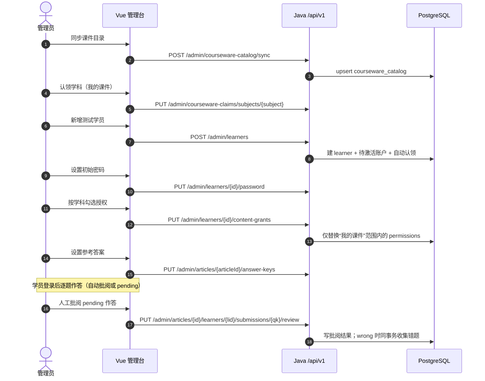
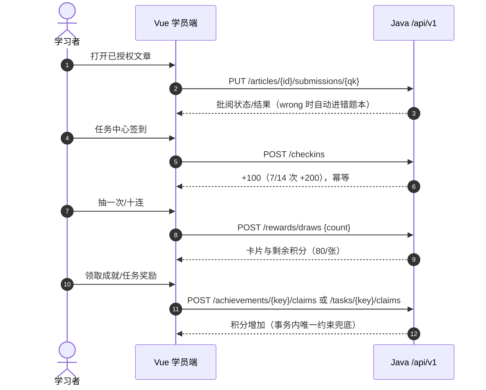

# NEST · 学巢 — 软件需求规格说明书（SRS）

| 项 | 内容 |
| --- | --- |
| 文档版本 | 1.3 |
| 状态 | 生效（随代码演进） |
| 更新日期 | 2026-10-31 |
| 适用仓库 | `tutor-base`（Vue 3 前端 + Java 模块化单体 + PostgreSQL） |
| 维护者 | 项目负责人（Lead）；任何行为变更需同步更新本文 |
| 事实来源 | 代码、`backend/api/openapi.yaml`、Flyway migration、自动化测试 |

> **文档优先级**：可执行代码与 OpenAPI contract 是最终事实来源；本文描述"系统应当做什么"，若与实现冲突，先修实现或先改本文，不允许长期并存。领域词汇以 [`CONTEXT.md`](../CONTEXT.md) 为准；接口细节以 [`api-standards.md`](api-standards.md) 与 `openapi.yaml` 为准；本文不重复字段级定义。

---

## 1. 引言

### 1.1 目的

本文定义一个面向单个教师团队与少量学习者的轻量学习平台的完整需求：谁能做什么、系统在什么条件下产生什么结果、哪些边界明确不做。它同时是验收依据和变更评审依据。

### 1.2 范围

覆盖：身份与会话、学习者与内容授权、多管理员学员认领、课件认领（学科/单篇/排除）、学习文章浏览与作答、自动与人工批阅、错题本与错题训练、每日签到与积分、抽卡与收藏、成长等级、分级成就、周期与限时任务、管理端统计、测试学员机制、系统运维接口。

不覆盖：支付与订阅、公开内容社区、家长端、IM 通知、多租户 SaaS、文章正文保密分发、移动原生客户端。

### 1.3 读者

- 产品/项目负责人：确认范围与优先级。
- 前后端开发者：了解规则、边界与验收条件。
- 测试与 CI：把验收条件转成测试用例。
- 运维/发布：了解运行环境、健康检查与数据迁移约束。

### 1.4 术语与缩写

| 术语 | 含义 | 权威定义 |
| --- | --- | --- |
| 学习者 / 学员 | 使用学习内容并提交作答的账户；UI 文案用"学员" | `CONTEXT.md` |
| 管理员 | 可管理学员、内容授权、参考答案与批阅的账户角色 | `CONTEXT.md` |
| 课件 | 管理员视角下需要维护答案与批阅的学习文章 | `CONTEXT.md` |
| 我的课件 | (我认领学科下全部课件 − 我排除的课件) ∪ 我单篇认领的课件 | `api-standards.md` §6 |
| 学习文章 | 拥有稳定 `articleId` 的学习内容（Markdown + 题目占位符） | `CONTEXT.md` |
| 题目标识 `questionKey` | 文章内的稳定文本标识，**不保证是整数** | `CONTEXT.md` |
| 作答 | 学习者对一道题当前保存的答案（覆盖式，不是历史流水） | `CONTEXT.md` |
| 批阅 | 对作答的审核状态与结果（`correct` / `partial` / `wrong`） | 本文 §3.5 |
| 错题条目 | 针对来源题目的复习记录，保留错因、笔记、掌握状态与出错次数 | `CONTEXT.md` |
| 签到 | 每自然日（Asia/Shanghai）至多一次的参与记录 | `CONTEXT.md` |
| 积分 | 可用积分（`points`），抽卡消耗；累计积分（`lifetime_points`）只增不减 | `CONTEXT.md` |
| 当期 UP | 按 ISO 周轮换的一张稀有卡，周一 00:00（Asia/Shanghai）切换 | `api-standards.md` §6 |
| 需求编号 | `FR-<域>-<序号>` 功能需求；`NFR-<类>-<序号>` 非功能需求 | 本文 §1.6 |
| 用户故事编号 | `US-<域><序号>` | [`用户故事.md`](用户故事.md) |
| 业务对象编号 | `BO-<类>-<序号>` | [`业务对象清单.md`](业务对象清单.md) |

### 1.5 参考文档

| 文档 | 用途 |
| --- | --- |
| [`CONTEXT.md`](../CONTEXT.md) | 领域词汇与反义词，禁止另造概念 |
| [`api-standards.md`](api-standards.md) | 跨 endpoint 协议、错误码、分页与并发约定 |
| [`backend/api/openapi.yaml`](../backend/api/openapi.yaml) | 机器可校验的接口 contract |
| [`backend-completion-matrix.md`](backend-completion-matrix.md) | 能力接管状态与验收矩阵 |
| [`code-standards.md`](code-standards.md) | 工程约束、测试分层、安全规范 |
| [`design-system.md`](design-system.md) | 前端视觉契约（Riso Campus） |
| [`用户故事.md`](用户故事.md) | 用户故事与验收标准 |
| [`业务对象清单.md`](业务对象清单.md) | 业务对象、状态机与表映射 |
| [`../AGENTS.md`](../AGENTS.md) | 协作流程、必须同步维护的契约、CI/CD 分工 |

### 1.6 需求标识与优先级

- 功能需求：`FR-ACC / FR-LRN / FR-CW / FR-CNT / FR-REV / FR-WB / FR-CHK / FR-RWD / FR-GRW / FR-ADM / FR-TST / FR-SYS`。
- 非功能需求：`NFR-SEC / NFR-PERF / NFR-AVL / NFR-COMP / NFR-MNT / NFR-OBS / NFR-PRIV`。
- 优先级：**P0** 缺失即不可上线；**P1** 本期应完成；**P2** 可延后但需保留设计空间。

---

## 2. 总体描述

### 2.1 产品定位

NEST（学巢）是一个小规模、强组织关系的家教学习平台：教师（管理员）为固定学员开通学科课件、维护参考答案并批阅；学员在浏览器中阅读讲义、逐题作答，通过错题本、签到、积分、抽卡、成就与任务维持学习节奏。产品强调"轻量、可信、可持续维护"，不追求社区化与商业化。

### 2.2 用户角色

| 角色 | 认证方式 | 核心权限 | 明确不能做 |
| --- | --- | --- | --- |
| 游客 Visitor | 无 | 浏览落地页、登录/注册、查看公开系统状态与卡池目录占位 | 读取任何学习数据 |
| 学习者 Learner | 用户名 + 密码，服务端会话 | 浏览已授权文章、作答、查看批阅结果与已批阅题的标准答案、管理自己的错题本、签到、抽卡、领奖 | 访问管理端、查看他人数据、修改授权/积分/批阅 |
| 管理员 Administrator | 同上，`role=administrator` | 学员管理、内容授权、课件认领、参考答案、人工批阅、统计、进入学员账号 | 修改他人认领的学员/课件；查看"我的课件"以外的学习数据；审核教师注册申请 |
| 超级管理员 Super Administrator | 同上，`role=administrator` + `is_super_admin=true`（当前为 `young`） | 管理员全部权限，外加查看和审核教师注册申请 | 通过公共接口自封超级管理员；绕过审核直接建管理员账户 |

管理员与学习者由**账户角色**区分，不由用户名或前端路由决定；超级管理员是管理员之上的**审核权限标记**，不是第四种业务角色，也不改变管理员的其他权限边界。

### 2.3 运行环境

| 层 | 技术 | 部署位置 |
| --- | --- | --- |
| 前端 | Vue 3.4、Vite 5、Pinia、Vue Router（hash 模式）、Font Awesome、KaTeX（CDN） | GitHub Pages，`https://learn.be-young.top` |
| 后端 | Java 21 LTS、Spring Boot 4.1、JdbcClient、Spring Security | 单实例容器，`https://api.be-young.top/api/v1`（staging 为 `staging-api.be-young.top`） |
| 数据库 | PostgreSQL 17（当前托管于 Supabase） | 受限运行角色 `tutor_base_runtime`，具备 DML 与 RLS 策略，无 DDL 权限 |
| 结构演进 | Flyway `V1`–`V18` + `database/reconciliation/` 一次性对齐脚本 | 迁移先于应用替换 |
| 静态内容 | `tutor-nest-vue/public/articles/**/*.md` + 自动生成的 `data/articles.json`、`data/id_map.json` | 与前端同一 Pages 站点 |

浏览器目标：Chrome/Edge（推荐）、Safari、Firefox；响应式断点 375 / 768 / 1440。

### 2.4 设计与技术约束

1. **浏览器不可信**：身份、角色、资源归属、内容授权、积分与状态转换全部由服务端判定；不接受客户端提交的 `studentId`、积分、角色、批阅结果来源、截止时间。
2. **单一可信入口**：所有动态业务数据经 `/api/v1`；前端不得直连数据库、不得引入 Supabase client / anon key。
3. **模块化单体**：按业务能力划分 package（`identity`、`learning`、`wrongbook`、`checkin`、`rewards`、`growth`、`administration`、`system`、`shared`），不按技术层全局分层。
4. **结构只经 Flyway 演进**：已执行 migration 不得修改；存量库用可重复执行的 reconciliation 对齐，再补授权与 RLS。
5. **内容即静态文件**：文章正文是公开静态资源；"内容授权"控制导航可见范围与学习数据访问，**不保证正文 URL 保密**。
6. **时间口径**：传输与持久化用 UTC（RFC 3339）；业务自然日/周以 `Asia/Shanghai` 判定；服务端通过注入的 `Clock` 取时。
7. **视觉契约**：页面只能引用 `theme.css` token；禁止毛玻璃、霓虹、深色赛博。

### 2.5 假设与依赖

- 学员规模为数十人量级、管理员为数人量级；单实例后端足够。
- 班级/学科集合由静态文章目录（`series` = 顶层目录）决定，新增学科 = 新增目录，不需改代码。
- 管理员之间以"认领"划分职责，平台不做组织层级或审批流。
- 抽卡积分是学习激励，不与法币、付费、兑换发生关系。
- GitHub Pages 与 API 为同一 site 的不同子域，依赖浏览器允许 first-party Cookie（必须用自定义域名验收，`*.github.io` 可能被第三方 Cookie 策略拦截）。
- 运行角色权限、RLS 与 Supabase 跨境连接延迟由运维脚本和配置承担（`DATABASE_CONNECTION_TIMEOUT_MS=20000`）。

### 2.6 明确不在范围内

| 不做 | 原因/替代 |
| --- | --- |
| 文章正文鉴权下载 | 当前为公开静态文件；若需保密，另立需求迁移到鉴权下载或私有对象存储 |
| 支付、订阅、积分兑换实物 | 积分仅站内激励 |
| 家长/监护人账号与成绩单推送 | 组织关系仅"管理员—学员" |
| 站内私信、评论、公开社区 | 无社交面，降低审核与隐私成本 |
| 多机构多租户隔离 | 单团队部署；如需多租户需重新设计授权模型 |
| 富文本可视化编辑器 | 文章由 Markdown 源文件维护 |
| 原生 App / 离线包 | PWA 未纳入本期 |

---

## 3. 功能需求

### 3.0 需求索引

| 域 | 能力 | 需求条数 |
| --- | --- | --- |
| FR-ACC | 账户、会话、CSRF、密码、教师注册审核 | 13 |
| FR-LRN | 学员管理与内容授权 | 7 |
| FR-CW | 课件目录与认领 | 5 |
| FR-CNT | 内容浏览、作答、自动批阅、进度 | 7 |
| FR-REV | 参考答案与人工批阅 | 5 |
| FR-WB | 错题本与错题训练 | 6 |
| FR-CHK | 每日签到 | 3 |
| FR-RWD | 积分、卡池、抽卡、收藏 | 4 |
| FR-GRW | 等级、成就、任务 | 6 |
| FR-ADM | 管理端统计与学员详情 | 4 |
| FR-TST | 测试学员与特殊测试学员 | 4 |
| FR-SYS | 系统状态、健康检查、迁移与审计 | 4 |
| **合计** | | **67** |

### 3.1 身份与会话（FR-ACC）

目标：建立可信账户身份，会话可过期、可撤销，所有写操作具备 CSRF 防护。

| ID | 需求 | 关键规则与边界 | 优先级 |
| --- | --- | --- | --- |
| FR-ACC-01 | 用户可用用户名与密码登录 | `POST /sessions`；用户名去空格后大小写不敏感匹配；密码 6–128 字符；失败统一 `401 invalid_credentials`，不暴露用户名是否存在；成功后轮换 session ID 并返回账户安全投影 | P0 |
| FR-ACC-02 | 游客可自助注册学习者账户 | `POST /accounts`；注册即建立会话；新账户无任何内容授权；用户名冲突返回 `409 username_conflict` 且不公开具体用户名 | P0 |
| FR-ACC-03 | 前端可查询与注销当前会话 | `GET /session` 返回当前账户投影并刷新 CSRF Cookie；`DELETE /session` 撤销服务端会话 | P0 |
| FR-ACC-04 | 已登录账户可修改密码 | `PUT /password`；校验当前密码；新密码 6–128；成功后撤销除当前会话外的全部会话 | P1 |
| FR-ACC-05 | 待激活账户可用一次性激活码激活 | `POST /account-activations/complete`；激活码只存哈希、短期有效、仅一次；无效/过期/已用时返回 `401 invalid_activation_token`；管理员可选发行激活码（`POST /admin/account-activations`，当前前端不使用） | P1 |
| FR-ACC-06 | 所有写请求受 CSRF 防护 | 前端先 `GET /csrf` 取得 token 并只存内存；`POST/PUT/PATCH/DELETE` 携带 `X-CSRF-TOKEN`；会话轮换后旧 token 失效，前端必须丢弃并重新获取；缺失/无效返回 `403 csrf_invalid` | P0 |
| FR-ACC-07 | 公开认证操作受限流保护 | 登录、注册、激活按来源地址默认 10 次/分钟，可通过 `TUTOR_PUBLIC_MUTATION_LIMIT`、`TUTOR_PUBLIC_MUTATION_WINDOW` 调整；超限返回 `429 rate_limited` + `Retry-After`；单实例内存限流，多实例需网关共享限流 | P1 |
| FR-ACC-08 | 管理员可设置或重置学员密码 | `PUT /admin/learners/{learnerId}/password`；**只能设置当前管理员自己认领的学员密码**，未认领或他人认领时 `403 learner_not_claimed`；首次设置把 `pending_activation` 转为 `active`；再次设置撤销该学员全部旧会话与未使用激活码；不能修改独立管理员、已禁用账户或无学习者身份的账户 | P0 |
| FR-ACC-09 | 游客可提交教师注册申请 | `POST /teacher-applications`；请求 `{username,password}`；只写 `teacher_registration_application`，**不建账户、不建会话、不返回登录态**；密码仅存 Argon2id 哈希；用户名去空格后大小写不敏感，已有账户或已有待审核申请返回 `409 username_conflict`；受公开写限流约束 | P0 |
| FR-ACC-10 | 超级管理员是可审计的账户标记，而不是用户名硬编码 | `account.is_super_admin boolean NOT NULL DEFAULT false`，且 `CHECK (NOT is_super_admin OR role='administrator')`；当前由 `young` 持有；会话投影返回 `superAdmin`；只有该标记可进入审核接口，普通管理员访问返回 `403 forbidden` | P0 |
| FR-ACC-11 | 超级管理员可查看教师申请队列 | `GET /admin/teacher-applications?status=pending｜approved｜rejected｜all`，缺省 `pending`；返回 `items` 与全局 `pendingCount`，按提交时间倒序，最多 500 条；只读接口 | P0 |
| FR-ACC-12 | 超级管理员可通过申请并创建管理员账户 | `POST /admin/teacher-applications/{id}/approve`；锁申请行后校验 `pending`；在同一事务内建 `role=administrator`、`status=active` 的账户并复用申请密码哈希，随后把申请置 `approved` 并记录审核人/时间；用户名已被占用返回 `409 username_conflict`，重复审核返回 `409 state_conflict`；通过后申请人原密码即可登录 | P0 |
| FR-ACC-13 | 超级管理员可驳回申请 | `POST /admin/teacher-applications/{id}/reject`，请求 `{reason}`；理由去空格后必填、≤500 字；置 `rejected` 并记录审核人/时间/理由；**不建账户**；被驳回后同一用户名可重新申请；重复审核返回 `409 state_conflict` | P1 |

**业务规则**

- 账户状态只有 `pending_activation` / `active` / `disabled`；`active` 必须有 `password_hash` 与 `activated_at`，`pending_activation` 两者必须为空（数据库 CHECK 约束兜底）。
- 会话 Cookie：本地 `TUTOR_SESSION`（可关闭 Secure）；生产 `__Host-TUTOR_SESSION; HttpOnly; Secure; Path=/; SameSite=Lax`，不设 `Domain`，前端不可读。
- 密码算法由 Spring Security 的 Argon2id 承担；会话与激活码在库中只存 SHA-256 摘要。
- 管理员登录后前端直接进入管理台；管理员访问学员端路由时统一重定向到 `/admin`。
- 教师注册申请状态只有 `pending` / `approved` / `rejected`；同一用户名同时最多一条 `pending`（部分唯一索引兜底），`approved` / `rejected` 为终态，不可再次审核。
- 审核通过与建管理员账户必须同事务：账户插入失败（用户名冲突）时申请保持 `pending`，不产生"半通过"状态。
- 申请密码只保存 Argon2id 哈希；审核通过直接复用该哈希，系统任何接口都不回显密码或哈希。
- 超级管理员标记与 `administrator` 角色分离；迁移 `V17` 把既有 `young` 标为超级管理员，`database/audit/teacher_registration_checks.sql` 审计"标记缺失/多超级管理员/已通过无账户"等异常。

### 3.2 学员管理与内容授权（FR-LRN）

目标：管理员维护学员名单、按学科/单篇开通课件，并对学员归属形成可协商、可取消的认领关系。

| ID | 需求 | 关键规则与边界 | 优先级 |
| --- | --- | --- | --- |
| FR-LRN-01 | 管理员可分页查询学员目录 | `GET /admin/learners`；按学员 ID 游标分页，默认 50、最大 100；返回已开通科目 `enrolledSubjects`、文章授权 `contentGrantArticleIds`、认领归属（`claimedByAccountId/claimedByUsername/claimedAt`）、`lastActivityAt`、`isTest`、`isSpecialTest`；排除 `role=administrator` 的账户 | P0 |
| FR-LRN-02 | 管理员可新增测试学员 | `POST /admin/learners`；**固定创建 `is_test=true` 的测试学员**，不进入管理统计；同时创建待设置密码账户；**创建者自动认领**该学员；用户名冲突 `409 username_conflict` | P0 |
| FR-LRN-03 | 管理员可认领/取消认领学员 | `PUT/DELETE /admin/learners/{learnerId}/claim`；一个学员至多一名认领管理员；重复认领幂等；被他人认领时 `409 learner_already_claimed`；取消未认领学员的认领幂等返回 `204`；认领与取消认领以 `FOR UPDATE` 串行化 | P1 |
| FR-LRN-04 | 管理员可删除学员 | `DELETE /admin/learners/{learnerId}`；**只能删除当前管理员自己认领的学员**，未认领或由他人认领时 `403 learner_not_claimed` / `409 learner_already_claimed`；**特殊测试学员禁止删除**（`409 special_test_learner_protected`）；学员关联管理员账户时 `409 administrator_learner_protected`；级联删除账户、会话、激活码、作答、错题、签到、积分、卡片、任务/成就记录 | P1 |
| FR-LRN-05 | 管理员可为学员原子替换科目归属与内容授权 | `PUT /admin/learners/{learnerId}/content-grants`；请求体 `{ articleIds, enrolledSubjects }`，**科目归属与文章授权分离**：开通科目只写 `student.subjects`，初始不授权该科目下任何文章；文章仍由 `articleIds` 独立决定；未传 `enrolledSubjects` 时保留既有科目；范围和科目均限定在"我的课件"内，范围外既有权保留，避免多名管理员互相覆盖 | P0 |
| FR-LRN-06 | 管理员可免密进入学员账号 | `POST /admin/learners/{learnerId}/impersonate`；**只能进入当前管理员自己认领的学员**，未认领或他人认领时 `403 learner_not_claimed`；还需 `role=learner` 且账户已激活；创建新会话并轮换 Cookie；不撤销管理员既有会话 | P1 |
| FR-LRN-07 | 学习者可查询自己的授权范围 | `GET /me/content-grants`；返回 `articleIds`；特殊测试学员返回目录全量并带 `allArticles=true` | P0 |

**业务规则**

- 认领只表达组织归属，不改变科目归属、内容授权、批阅权限或学员可见范围。
- 查看学员详情、设置/重置密码、进入账号、删除学员都要求"当前管理员认领该学员"；未认领或他人认领统一返回 `403 learner_not_claimed`。
- 科目归属落库为 `student.subjects text[]`，文章授权仍落库为 `student.permissions integer[]`；两者相互独立，开通科目不会自动产生文章授权。
- 前端"学员科目"页只切换 `subjects`；取消科目时同步移除该科已授权文章，开通科目时不新增任何文章。
- 最近动态 = `max(作答更新, 错题更新, 签到创建, 登录会话认证时间)`，由服务端聚合，客户端不得提交。

### 3.3 课件目录与认领（FR-CW）

目标：多管理员共存时，把"哪些课件由谁维护"变成显式、可释放、可恢复的关系，并让所有管理写操作按"我的课件"收敛。

| ID | 需求 | 关键规则与边界 | 优先级 |
| --- | --- | --- | --- |
| FR-CW-01 | 管理端可同步静态课件目录 | `POST /admin/courseware-catalog/sync`；由前端把 `articles.json` 的 `articleId → 学科/标题` 幂等 upsert 入库；目录是"课件身份映射"，不是文章本身 | P0 |
| FR-CW-02 | 管理员可认领/释放学科 | `PUT/DELETE /admin/courseware-claims/subjects/{subject}`；认领覆盖该学科当前及未来新增课件；学科与管理员多对多，不独占；认领时清理该科排除，释放时仅靠学科覆盖的课件回到待认领，单篇认领保留 | P0 |
| FR-CW-03 | 管理员可认领/释放单篇课件 | `PUT/DELETE /admin/courseware-claims/articles/{articleId}`；单篇认领独立于学科认领；在学科覆盖下释放单篇会写入**排除**记录，重新单篇认领或重新认领学科时清除排除；重复操作幂等 | P0 |
| FR-CW-04 | 管理员可查看课件认领目录 | `GET /admin/courseware-claims/catalog?scope=mine｜unclaimed｜all`；返回学科汇总、认领归属、当前管理员的 `excluded` 标记；未认领/被自己排除的课件在业务页隐藏，但目录仍返回元信息 | P1 |
| FR-CW-05 | 管理写操作限定在"我的课件"范围 | 参考答案读写、学员作答状态、人工批阅、学员作答进度、科目/内容授权替换均限定范围；范围外返回 `403 courseware_not_claimed` | P0 |

**业务规则（可见范围公式）**

```text
我的课件(admin) = { article | article.subject ∈ admin.claimedSubjects
                            ∧ (admin, article) ∉ excluded }
                  ∪ { article | (admin, article) ∈ singleClaims }
```

- 学科认领**不物化**每篇归属行，因此新增课件自动进入覆盖范围；这是"覆盖未来"语义的关键。
- 单篇排除只对"本已被自己学科覆盖"的课件有意义；释放学科时一并清理该科排除。
- 未认领课件的正文仍可读（公开静态资源），只是不进入管理业务统计与写操作。

### 3.4 内容浏览与作答（FR-CNT）

目标：学习者按授权阅读讲义、逐题作答，系统在同一事务内完成自动批阅与错题收集。

| ID | 需求 | 关键规则与边界 | 优先级 |
| --- | --- | --- | --- |
| FR-CNT-01 | 学习者可浏览已授权的学科与文章目录 | 目录来自静态 `articles.json`（按 `series` 分学科、按路径建树）；可见范围由 `permissions` 或"特殊测试全量"决定；文章按 ID 稳定排序 | P0 |
| FR-CNT-02 | 文章可渲染为可读页面 | 支持 Markdown、`$...$` / `$$...$$` KaTeX、`![[图片名｜尺寸｜对齐｜标题]]` 图片嵌入、`---` 双栏、h1/h2 目录侧边栏、答题卡；首屏外图片懒加载 | P0 |
| FR-CNT-03 | 文章可声明题目并提供稳定题目标识 | 占位符 `【@】`（自动编号）/ `【@N】`（显式编号，推荐）插入答题卡片；`【题干N】` / `【题干N-M】` 标记题干片段并拼接为错题本题干（截断 400 字）；题目标识为字符串，前端不得假设为整数 | P0 |
| FR-CNT-04 | 学习者可保存/更新当前作答 | `PUT /articles/{articleId}/submissions/{questionKey}`；必须已授权该文章；同一题重复提交覆盖当前作答，不产生历史流水、不重复累加错题次数；**已批阅的作答不得再提交**（`409 submission_already_reviewed`），前端锁定 | P0 |
| FR-CNT-05 | 系统按参考答案自动批阅 | 仅当该题存在参考答案且 `auto_grade=true` 且答案非空时自动批阅；比较前仅统一换行符（`\r\n`/`\r` → `\n`），不 trim、不改写答案；完全一致判 `correct`，否则 `wrong`；命中 `wrong` 时在同一事务内收集/复活错题；否则状态为 `pending` | P0 |
| FR-CNT-06 | 标准答案按可见性规则揭示 | 学习者只在该题已批阅（`reviewed`）后看到参考答案；管理员在自己的"我的课件"内可直接查看；考试/未批阅状态不泄露答案 | P0 |
| FR-CNT-07 | 学习者可查看作答进度 | `GET /articles/study-progress`；只统计当前已授权文章；返回每题提交与批阅状态，用于分类页提醒与首页进度 | P1 |

**业务规则**

- 自动批阅与错题收集必须在同一 transaction 内完成；任何一步失败整体回滚。
- "错过一次"的判定：只有本次结果为 `wrong` 才产生收集/累加事件；`correct`/`partial` 不改变 `wrong_count`。
- 文章无题目时，答题卡与"待设置答案"筛选都应视为"无需处理"。
- 文章正文路径用 `import.meta.env.BASE_URL` 拼接，禁止写死站点根路径。

### 3.5 参考答案与人工批阅（FR-REV）

目标：管理员整组维护答案与自动批阅开关，并对需要人工判断的作答给出三档结论。

| ID | 需求 | 关键规则与边界 | 优先级 |
| --- | --- | --- | --- |
| FR-REV-01 | 管理员可查询/整组替换参考答案 | `GET/PUT /admin/articles/{articleId}/answer-keys`；PUT 提交该文章完整 `items` 集合（`questionId`、`answerText`、`autoGrade`）；范围为"我的课件"，范围外 `403 courseware_not_claimed` | P0 |
| FR-REV-02 | 管理端可定位已设置答案的文章 | `GET /admin/articles/answer-key-article-ids`；只返回"我的课件"中已设置答案的文章 ID；答案面板提供"待设置/已设置/全部"三种视图，**无题文章不计入待设置**，打开时提示无需设置 | P1 |
| FR-REV-03 | 管理员可查看指定学员的文章作答状态 | `GET /admin/articles/{articleId}/study-state?learnerId=`；返回每题作答、批阅与答案；仅限"我的课件" | P0 |
| FR-REV-04 | 管理员可保存人工批阅结果 | `PUT /admin/articles/{articleId}/learners/{learnerId}/submissions/{questionKey}/review`；结果只能是 `correct` / `partial` / `wrong`；写入后状态转 `reviewed` 并记录 `reviewed_at`；`wrong` 时同事务收集/复活错题 | P0 |
| FR-REV-05 | 批阅与待批阅统计按管理员课件范围收敛 | 只处理"我的课件"内的作答；**不按学员当前内容授权二次过滤**，授权收回后历史作答仍计入待批阅与进度（管理员可继续批阅历史作答） | P1 |

**业务规则**

- 人工批阅不修改学员答案，只写审核状态与结果。
- 待批阅定义：`review_status='pending'`（通常因无答案键、自动批阅关闭或人工改判前置状态）。
- 数据库 CHECK 约束保证 `pending` 时无 `review_result`/`reviewed_at`，`reviewed` 时两者必须齐备。

### 3.6 错题本与错题训练（FR-WB）

| ID | 需求 | 关键规则与边界 | 优先级 |
| --- | --- | --- | --- |
| FR-WB-01 | 系统自动收集错题 | 作答或人工批阅结果为 `wrong` 时，按 `(learnerId, articleId, questionKey)` upsert；已存在则更新最近答案/正确答案、`removed=false`、`wrong_count+1`、`is_manual=false` | P0 |
| FR-WB-02 | 学习者可手动收集一道题 | `POST /wrong-book/entries`；必须提供来源文章与题目标识；已存在未移除条目返回冲突（`409`）；新条目 `is_manual=true`、`wrong_count=1` | P1 |
| FR-WB-03 | 学习者可查询自己的错题 | `GET /wrong-book`；只返回未移除条目；含最近答案、正确答案（仅在来源作答已批阅时可见）、错因、标签、笔记、掌握状态、出错次数 | P0 |
| FR-WB-04 | 学习者可编辑错因、笔记、标签与掌握状态 | `PATCH /wrong-book/entries/{entryId}`；owner 隔离；`mastered` 只置标记，不清零 `wrong_count`、不删除条目 | P0 |
| FR-WB-05 | 学习者可删除条目 | `DELETE /wrong-book/entries/{entryId}`；手动条目硬删除，自动条目软删除（`removed=true`）；之后再次答错自动条目会复活 | P1 |
| FR-WB-06 | 学习者可进入错题训练重做 | 独立页面从错题本取题重做，答案在本地按标准答案判定（或由用户自评）；**训练答错时前端只在当前页面把出错次数 +1，服务端 `PATCH /wrong-book/entries/{id}` 当前不接收 `wrong_count`，刷新后不保留**（已知缺口，见 §9）；训练不改变原文章作答 | P1 |

**业务规则**

- 错题条目不是题目副本：来源题目的身份由 `(source_blog_id, source_question_id)` 决定，删除来源文章不会删除学员的复习记录（当前实现由学员主动删除/系统保留）。
- `wrong_count` 是"出错次数"，`mastered` 是"是否已掌握"，两者独立，避免"掌握即清零"造成数据丢失。

### 3.7 每日签到与积分（FR-CHK）

| ID | 需求 | 关键规则与边界 | 优先级 |
| --- | --- | --- | --- |
| FR-CHK-01 | 学习者可查看某自然月签到情况 | `GET /checkins?year=&month=`；返回该月签到日期、本月次数、今日是否已签、奖励规则；"今日"按 Asia/Shanghai；每月 1 日重置月计数 | P0 |
| FR-CHK-02 | 学习者可执行当日签到 | `POST /checkins`；每自然日至多一次；每次 `+100` 积分；每月第 7、14 次当天额外 `+100`（当日共 200）；同日重复调用幂等返回 `alreadyCheckedIn`，不重复加分 | P0 |
| FR-CHK-03 | 签到与积分写入由服务端事务完成 | 记录写 `daily_check_in`，积分原子累加 `user_points`；并发双请求由唯一键兜底，落败方回读胜者记录；客户端不得直接写表 | P0 |

**业务规则**

- 无 `learnerId` 的账户（如独立管理员）调用返回 `403 learner_context_required`。
- 签到创建的 `created_at` 同时作为"学员最近动态"的候选时间。

### 3.8 积分、卡池与抽卡（FR-RWD）

| ID | 需求 | 关键规则与边界 | 优先级 |
| --- | --- | --- | --- |
| FR-RWD-01 | 学习者可查看积分与收藏汇总 | `GET /rewards`；返回可用积分、累计积分、抽卡次数、卡片收藏（含总数与不重复数、卡池规模）；特殊测试学员返回固定 `999999999` | P0 |
| FR-RWD-02 | 卡池目录由数据库驱动 | `GET /rewards/catalog`；返回抽卡价格、稀有概率、UP 概率、当期 UP 卡与全部启用卡组；新增卡组只需插入数据行 | P0 |
| FR-RWD-03 | 学习者可抽卡 | `POST /rewards/draws`；`count` 1–10；每张 80 积分；稀有 5%，命中稀有后 50% 为当期 UP；服务端决定卡组、稀有度与卡片；扣分、写入收藏、累加 `draw_count` 在同一事务；积分不足 `409 insufficient_points` | P0 |
| FR-RWD-04 | 当期 UP 确定性轮换 | 以 ISO 周数对启用卡组数取模确定 UP 卡组，下一期生效时间为下周一 00:00（Asia/Shanghai）；每卡组最多一张启用稀有卡（部分唯一索引兜底） | P1 |

**业务规则**

- 抽卡只扣 `points`；`lifetime_points` 只增不减，用于等级与成就，不受消费影响。
- 客户端只能提交 `count`；不得提交或决定 `studentId`、`cardKey`、`setKey`、`rarity`、`isUp`。
- 特殊测试学员抽卡不扣积分（`points` 固定展示值）。
- 收藏允许重复获得同一张卡；统计区分 `COUNT(DISTINCT card_key)` 与总数。

### 3.9 成长等级、成就与任务（FR-GRW）

| ID | 需求 | 关键规则与边界 | 优先级 |
| --- | --- | --- | --- |
| FR-GRW-01 | 系统按累计积分推导成长等级 | `level = floor(lifetime_points / 200) + 1`；等级本身不发放积分；前端只做展示与动画，不写积分 | P1 |
| FR-GRW-02 | 学习者可查看分级成就并领取奖励 | `GET /achievements`；返回每个成就的指标当前值、各档要求与领取状态、可领取等级 | P0 |
| FR-GRW-03 | 领取成就按"成就×等级"唯一 | `POST /achievements/{key}/claims`；只能领取下一级已达成档位；奖励积分由服务端目录决定并原子累加；重复领取 `409 achievement_already_claimed`，未达成 `409 achievement_not_claimable` | P0 |
| FR-GRW-04 | 学习者可查看任务板 | `GET /tasks/board`；返回每日、每周、限时任务的进度、状态、刷新时间与奖励 | P0 |
| FR-GRW-05 | 限时任务需先接取 | `POST /tasks/{key}/accept`；服务端写入 `accepted_at` 与宽松 `deadline_at`；重复接取 `409 task_already_accepted`；过期后 `409 task_expired` 且可重新接取 | P1 |
| FR-GRW-06 | 任务奖励按周期唯一领取 | `POST /tasks/{key}/claims`；仅已完成可领；同一周期/同一次接取只能领一次；未接取 `409 task_not_accepted`，未完成 `409 task_not_completed`，重复 `409 task_already_claimed` | P0 |

**目录（当前版本，改目录需同步本文与测试）**

| 类型 | 键 | 指标 | 目标 | 奖励 |
| --- | --- | --- | --- | --- |
| 每日 | `daily-submit` | 提交作答数 | 2 | 20 |
| 每日 | `daily-collect` | 收集错题数 | 1 | 20 |
| 每日 | `daily-master` | 掌握错题数 | 1 | 30 |
| 每周 | `weekly-submit` | 提交作答数 | 8 | 80 |
| 每周 | `weekly-master` | 掌握错题数 | 3 | 100 |
| 每周 | `weekly-checkin` | 签到天数 | 5 | 80 |
| 限时 | `sprint-submit` | 接取后 7 天内提交 | 6 | 120 |
| 限时 | `sprint-master` | 接取后 10 天内掌握 | 2 | 150 |
| 限时 | `sprint-collect` | 接取后 7 天内收集 | 3 | 100 |

成就共 7 项：`checkin`、`submission`、`mastery`、`collection`、`reading`（有题目文章全部题已提交）、`cards`（不重复卡数，按卡池总量 5/15/30/50/75/100% 缩放）、`obtained`（含重复累计获卡数）。每项最多 7 档，每档只可领一次。

**业务规则**

- 周期任务按 Asia/Shanghai 自然日/自然周刷新；跨周时 `period_key` 变化即视为新周期。
- 领取记录写入与积分累加在同一数据库事务；数据库唯一约束兜底并发重复领取。
- 限时任务截止时间刻意覆盖工作日（7/10 天窗口），避免"当天必须完成"。

### 3.10 管理端统计与学员详情（FR-ADM）

| ID | 需求 | 关键规则与边界 | 优先级 |
| --- | --- | --- | --- |
| FR-ADM-01 | 管理台概览指标 | `GET /admin/analytics/overview`；我的学员/总学员/近 7 天活跃/待批阅/近 7 日提交；**学习类指标只统计"我的课件"**；学员目录、积分与签到为全局口径 | P1 |
| FR-ADM-02 | 近 7–90 天提交/批阅趋势 | `GET /admin/analytics/activity?days=`；按 Asia/Shanghai 自然日补零；只统计"我的课件" | P1 |
| FR-ADM-03 | 学员详情 | `GET /admin/learners/{learnerId}/profile`；积分/累计/等级、近 30 天签到、分学科进度、最近 10 条作答、30 天动态；学习数据只含"我的课件"；**只能查看当前管理员自己认领的学员**，未认领或他人认领时 `403 learner_not_claimed` | P1 |
| FR-ADM-04 | 统计排除测试学员 | 概览的学员计数、活跃度、提交/批阅趋势排除 `is_test`；管理端切换器单独分组展示 | P1 |

**业务规则**

- 统计接口只读，不写任何状态；失败时前端保留本地课件指标并提示，不白屏。
- "活跃"口径：近 7 天存在作答/错题/签到/登录会话时间，不代表在线。

### 3.11 测试学员与特殊测试学员（FR-TST）

| ID | 需求 | 关键规则与边界 | 优先级 |
| --- | --- | --- | --- |
| FR-TST-01 | 可标记测试学员 | `student.is_test`；保留正常登录与学习能力，但不进入管理员侧活跃度、动态与统计展示；`is_special_test` 必须同时 `is_test` | P1 |
| FR-TST-02 | 特殊测试学员全局唯一且拥有全量能力 | 部分唯一索引保证最多一个；拥有全部课件访问权限（`permissions` 由目录补齐 / 接口返回 `allArticles=true`）；`/rewards` 返回固定 `999999999` 且抽卡不减少 | P1 |
| FR-TST-03 | 特殊测试学员禁止删除 | `DELETE /admin/learners/{learnerId}` 先于认领校验检查 `is_special_test`，命中返回 `409 special_test_learner_protected`；仅允许通过数据库运维流程处理 | P1 |
| FR-TST-04 | 测试学员在管理端可识别 | 学员列表返回 `isTest`/`isSpecialTest`；切换器与列表分组展示，避免误当真实学员操作；特殊测试学员不显示"删除学员"按钮 | P2 |

**业务规则**

- 特殊测试学员用于端到端验收与演示，不得当作真实计费或统计对象。
- 标记是数据属性，不是角色；管理员不能通过改名获得特殊能力。

### 3.12 系统状态、健康检查与运维（FR-SYS）

| ID | 需求 | 关键规则与边界 | 优先级 |
| --- | --- | --- | --- |
| FR-SYS-01 | 公开系统状态 | `GET /system/status` 返回 `status/service/version/time`；`version` 来自 build metadata，未知时 `dev`；不泄露 profile、hostname、JVM 参数、数据库 URL、用户名或 secret | P1 |
| FR-SYS-02 | 健康检查分层 | `/actuator/health/liveness` 只判进程存活；`/actuator/health/readiness` 在接流量前验证必要依赖；其他 actuator endpoint 不对公网开放 | P0 |
| FR-SYS-03 | 数据库结构只经版本化迁移演进 | 空库可由 Flyway `V1`→`V18` 完整迁移；存量库用 `database/reconciliation/*.sql` 幂等对齐后补授权与 RLS；已执行 migration 不得修改 | P0 |
| FR-SYS-04 | 发布前后具备审计与密钥扫描 | 仓库 secret scan 覆盖提交内容；运行角色权限与浏览器表权限有独立审计脚本；发布使用不可变 commit SHA 镜像并在替换前完成迁移 | P1 |

**业务规则**

- 迁移与运行角色分离：Flyway 用具备 DDL 的账户执行；应用使用 `tutor_base_runtime`（仅 DML + RLS）。
- 健康检查不得执行昂贵查询；readiness 失败必须阻止应用替换。
- 浏览器角色对业务表的直接权限最终应被撤销，且必须在旧前端下线后执行。

### 3.13 关键端到端流程

**流程 A：管理员开通学员并完成一次批阅**



**流程 B：学习者学习—签到—抽卡**



---

## 4. 非功能需求

### 4.1 安全（NFR-SEC）

| ID | 需求 | 验证方式 |
| --- | --- | --- |
| NFR-SEC-01 | 会话使用 HttpOnly + Secure + SameSite=Lax 的 opaque Cookie，服务端轮换 ID，前端不可读取 | 生产配置检查 + `IdentityHttpContractTest` |
| NFR-SEC-02 | 全部写操作受 CSRF 保护；token 只存内存、与会话绑定 | `IdentityHttpContractTest`、前端 `backendClient.test.js` |
| NFR-SEC-03 | 密码 6–128 字符，Argon2id 存储；激活码/会话只存哈希；日志不含密码、session、token、完整答案 | 代码评审 + secret scan |
| NFR-SEC-04 | 角色、资源归属、内容授权、积分与状态转换由服务端判定；默认拒绝未认证 `/api/**` | MockMvc 401/403 用例 |
| NFR-SEC-05 | 公开认证操作限流；登录错误不暴露用户名是否存在 | 契约测试 + 配置项 |
| NFR-SEC-06 | CORS 只允许精确 origin 且 `Access-Control-Allow-Credentials: true`，禁止 `*` | `ProductionConfigurationValidatorTest` |
| NFR-SEC-07 | 运行数据库角色无 DDL 权限；RLS 策略覆盖业务表；浏览器角色最终无业务表直写权限 | `runtime_role_checks.sql`、`browser_table_access_checks.sql` |
| NFR-SEC-08 | 管理端只读统计与写操作都收敛到"我的课件"，越权返回稳定错误码 | `CoursewareClaimHttpContractTest` |

### 4.2 性能与容量（NFR-PERF）

| ID | 需求 | 说明 |
| --- | --- | --- |
| NFR-PERF-01 | 读接口在单实例、数十学员规模下保持交互可用 | 列表使用游标分页（默认 50/最大 100）；统计按"我的课件"过滤并补零，不做全表扫描 |
| NFR-PERF-02 | 写操作保持短事务 | 作答+自动批阅+错题收集、签到+积分、抽卡+收藏+计数、领奖+积分为单事务 |
| NFR-PERF-03 | 前端首屏可感知加载状态 | 路由进度条、骨架屏、chunk 失败自动刷新一次、渲染异常兜底页 |
| NFR-PERF-04 | 量化 SLO 待压测后补充 | 当前**未**对 P95 延迟、并发量做对外承诺；如需承诺，先在生产同规格环境压测并回写本节 |

> 说明：本文不虚构性能指标。`DATABASE_CONNECTION_TIMEOUT_MS` 与 `DATABASE_POOL_MIN_IDLE` 在本地与生产模板中分别为 `5000` / `0`，属于可调可用性参数；跨境连接频繁超时时可调高超时并重启，但不是性能承诺。

### 4.3 可用性与可靠性（NFR-AVL）

| ID | 需求 |
| --- | --- |
| NFR-AVL-01 | readiness 在依赖不可用时失败，阻止接流量与发布；发布失败保留可执行回滚路径 |
| NFR-AVL-02 | 数据库缺表/缺权限时接口返回 `503 dependency_unavailable` 而非 500；前端提示可操作的处理指引 |
| NFR-AVL-03 | 同日重复签到、重复接取/领取、重复认领均幂等或返回稳定冲突码，不产生双写 |
| NFR-AVL-04 | 前端 chunk 失效自动恢复一次；仍失败展示兜底页并允许重试 |

### 4.4 兼容性与易用性（NFR-COMP）

| ID | 需求 |
| --- | --- |
| NFR-COMP-01 | 375 / 768 / 1440 三档布局成立；触控目标 ≥ 40px；底部为移动导航预留 ≥ 88px |
| NFR-COMP-02 | 支持 hash 路由，兼容 GitHub Pages 子路径部署；资源路径使用 `BASE_URL` |
| NFR-COMP-03 | 交互四态（hover/focus/active/disabled）齐全；异步有 loading 与成功/失败反馈；危险操作二次确认 |
| NFR-COMP-04 | 视觉遵循 `design-system.md`：纸感、墨线、印刷色块，禁止毛玻璃/霓虹/深色赛博 |

### 4.5 可维护性与测试（NFR-MNT）

| ID | 需求 |
| --- | --- |
| NFR-MNT-01 | 分层测试：纯规则 `*Test`；HTTP 契约 `*HttpContractTest`；Spring/PostgreSQL `*IntegrationTest`；`FlywayMigrationTest` 覆盖空库与存量对齐两条路径 |
| NFR-MNT-02 | 任何 endpoint 变更与 `openapi.yaml` 同一提交；`npm run test:openapi` 通过 |
| NFR-MNT-03 | 一次行为变更同步维护 `CONTEXT.md`、OpenAPI、`api-standards.md`、`backend-completion-matrix.md` 与本文 |
| NFR-MNT-04 | 前端 gateway 按能力划分，页面/store 不得直连数据库；错误统一 Problem Details 映射 |
| NFR-MNT-05 | 依赖与 Action 固定版本；CI 与本地使用同一命令与同一 Node/Java 主版本 |

### 4.6 可观测性与隐私（NFR-OBS / NFR-PRIV）

| ID | 需求 |
| --- | --- |
| NFR-OBS-01 | 每个请求生成/保留 `traceId`；Problem Details 可返回 traceId，但不含内部异常文本 |
| NFR-OBS-02 | 结构化日志；INFO 记录部署版本与关键业务结果，WARN 记录可恢复异常，ERROR 仅用于需人工处理 |
| NFR-OBS-03 | actuator 只公开 health；metrics/env/config 仅内网或管理员可见 |
| NFR-PRIV-01 | 只收集用户名与学习行为数据；不采集身份证、手机号、支付信息、精确位置 |
| NFR-PRIV-02 | 学员数据仅对本人、其认领管理员与系统运维可见；删除学员时级联清理其学习数据 |
| NFR-PRIV-03 | 日志、错误响应、前端 storage 不出现密码、会话值、激活码、完整答案正文 |

---

## 5. 数据需求

1. **身份与结构**：账户、学习者、文章、题目、作答、错题、签到、积分、卡片、任务、认领、教师注册申请均以数据库表持久化；详见 [`业务对象清单.md`](业务对象清单.md)。
2. **标识**：`articleId` 为整数且不超过 JS safe integer；`questionKey` 为字符串；`entryId`/`learnerId` 为整数；未来新资源优先 UUID string。
3. **完整性**：主键、外键、唯一键、CHECK、必要索引必须在 migration 中显式声明；外键列通常单独建索引。
4. **时间**：持久化与传输 UTC；业务日/周按 Asia/Shanghai；信用注入 `Clock`，便于测试固定时间。
5. **保留与删除**：删除学员级联删除其会话、作答、错题、签到、积分、卡片、任务/成就；错题手动条目硬删、自动条目软删；文章为静态文件，删除源文件不自动清理历史作答（需单独数据治理）。
6. **可重复执行**：reconciliation 脚本必须幂等；Flyway migration 对"已手工对齐但未记账"的库也要能成功（V11/V12/V15/V16/V17/V18 已按此实现）。

---

## 6. 外部接口需求

| 接口 | 方向 | 约定 |
| --- | --- | --- |
| `https://api.be-young.top/api/v1` | 前端 → 后端 | JSON camelCase；集合 `{items,nextCursor}`；错误 Problem Details；`credentials: include` |
| `https://learn.be-young.top` | 浏览器 → Pages | 静态站点；hash 路由；`base` 由工作流按自定义域名计算 |
| `public/articles/**/*.md` | 前端 → Pages | 公开静态内容；由 `sync-articles-data.js` 生成索引，ID 只增不减 |
| `GET /csrf` | 前端 → 后端 | 白名单 origin 才发放；token 仅内存 |
| SMTP / IM / 支付 | — | 本期无 |

API 清单以 `openapi.yaml` 的 46 个路径为准（截至 2026-10-31）；新增/删除路径必须同步本文 §8 追踪表。本轮补齐了原先缺失的 `POST /accounts`，并新增教师申请提交、审核列表、通过、驳回 4 个路径。

---

## 7. 验收与测试门槛

| 层级 | 覆盖 | 命令 |
| --- | --- | --- |
| 单元 | 答案归一与自动批阅、奖励目录映射、任务/成就目录、错题删除/复活规则 | `cd backend; .\mvnw.cmd -B -ntp test` |
| PostgreSQL 集成 | Flyway V1→V18、约束/外键、积分原子变更、作答与错题同事务回滚、迁移第二次执行 0 步 | `.\mvnw.cmd -B -ntp verify`（Testcontainers，禁止 H2） |
| HTTP 契约 | 每个 endpoint 的成功、401、403、400/409 与 Problem Details code；教师申请提交/审核通过/驳回与超级管理员越权 | `*\HttpContractTest` |
| 前端 | gateway 请求/响应映射、CSRF 单次刷新、store 状态、无 Supabase import | `npm run test:frontend` |
| 静态检查 | SFC/模板编译、OpenAPI lint、secret scan、构建 | `npm run check:sfc`、`npm run test:openapi`、`npm run test:secrets`、`npm run build` |
| E2E | 管理员建号/授权/设答案/设密、进入学员、越权拒绝、作答、错题编辑删除、签到、奖励拒绝、人工批阅与自动收集 | `npx playwright install chromium`；`.\scripts\e2e-local.ps1` |

**整体验收判定**：上述全部通过，且 §8 追踪表中每个 P0 需求至少有一条自动化用例或明确的人工验收记录。

---

## 8. 需求追踪

| 需求 | 用户故事 | 主要接口 | 业务对象 / 表 | 主要测试 |
| --- | --- | --- | --- | --- |
| FR-ACC-01/02/03/04 | US-A01–A04 | `/sessions`、`/accounts`、`/session`、`/password` | Account、Session → `account`、`account_session` | `IdentityHttpContractTest` |
| FR-ACC-05/08 | US-A05、B06 | `/account-activations/complete`、`/admin/.../password` | Account Activation → `account_activation` | `IdentityHttpContractTest`、`AdminLearnerHttpContractTest` |
| FR-ACC-06/07 | US-A06 | `/csrf` | Session | `IdentityHttpContractTest`、`backendClient.test.js` |
| FR-ACC-09–13 | US-A07–A09 | `/teacher-applications`、`/admin/teacher-applications*` | Teacher Registration Application、Super Administrator → `teacher_registration_application`、`account.is_super_admin` | `IdentityHttpContractTest`、`teacherApplicationGateway.test.js`、`FlywayMigrationTest` |
| FR-LRN-01–07 | US-B01–B07 | `/admin/learners*`、`/me/content-grants` | Learner、Learner Claim、Content Grant → `student`、`account` | `AdminLearnerHttpContractTest`、`LearnerContentGrantHttpContractTest` |
| FR-CW-01–05 | US-C01–C05 | `/admin/courseware-*` | Courseware Catalog/Claim/Exclusion → `courseware_catalog`、`admin_subject_claim`、`admin_courseware_claim`、`admin_courseware_exclusion` | `CoursewareClaimHttpContractTest` |
| FR-CNT-01–07 | US-D01–D06 | `/articles/**` | Learning Article、Question、Submission、Answer Key | `LearningAndWrongBookHttpContractTest`、`AnswerGradingPolicyTest` |
| FR-REV-01–05 | US-E01–E04 | `/admin/articles/**` | Answer Key、Review | `LearningAndWrongBookHttpContractTest` |
| FR-WB-01–06 | US-F01–F06 | `/wrong-book/**` | Wrong Question Entry、Mastery → `wrong_questions` | 同上；训练次数持久化为已知缺口 |
| FR-CHK-01–03 | US-G01–G03 | `/checkins` | Daily Check-in → `daily_check_in`、`user_points` | `CheckInHttpContractTest` |
| FR-RWD-01–04 | US-H01–H04 | `/rewards*` | Card Pool、Draw、Collection → `card_sets`、`card_definitions`、`card_collection` | `RewardHttpContractTest`、`RewardCatalogTest` |
| FR-GRW-01–06 | US-I01–I05 | `/achievements*`、`/tasks/**` | Achievement/Task → `achievement_claims`、`task_assignments`、`task_claims` | `AchievementCatalogTest`、`TaskCatalogTest` |
| FR-ADM-01–04 | US-J01–J03 | `/admin/analytics/*`、`/admin/learners/{id}/profile` | Learner Activity、Study Progress | `AdminAnalyticsHttpContractTest` |
| FR-TST-01–04 | US-K01–K03 | `/admin/learners`、`/rewards`、`/me/content-grants` | Test Learner | `TestLearnerHttpContractTest`、`AdminLearnerHttpContractTest`、`FlywayMigrationTest` |
| FR-SYS-01–04 | US-L01–L04 | `/system/status`、`/actuator/health/*` | System Status、Migration | `SystemHttpContractTest`、`FlywayMigrationTest`、`ProductionConfigurationValidatorTest` |

---

## 9. 风险、边界与开放问题

| 风险/问题 | 影响 | 当前处置 |
| --- | --- | --- |
| 文章正文是公开静态文件 | 未授权者可凭 URL 读到正文；"内容授权"只约束导航与学习数据 | 已在 `backend-delivery-status.md` 记录为产品边界；若需保密另立需求 |
| 单实例内存限流 | 多实例或重启后限流不共享 | 扩展时在统一网关加共享限流 |
| 无量化性能 SLO | 对外承诺缺乏依据 | NFR-PERF-04 明确"压测后补充" |
| 存量库与空库结构可能漂移 | 升级可能因"对象已存在"失败 | migration 幂等 + reconciliation + 双路径 `FlywayMigrationTest` |
| 特殊测试学员拥有固定高积分 | 若被当真实数据会污染统计 | 统计排除 + 管理端分组标注 |
| 抽卡概率（5% 稀有 / UP 50%）为激励设计 | 玩家体验与公平性 | 概率服务端固定、目录可审计；不涉及付费 |
| 管理员之间对同一学员/学科的理解差异 | 误操作、互相覆盖 | 认领+范围收敛+范围外授权保留 |
| 超级管理员是审核单点 | `young` 账户不可用时无人能通过教师申请 | 标记保存在 `account.is_super_admin`，可由运维显式转移（无自助接口）；审计脚本监控标记数量与异常 |
| 错题训练答错次数只在前端 +1 | 刷新后回退，学习数据与页面不一致 | 已在 FR-WB-06 与 `业务对象清单.md` 标注；修复方向：扩展 PATCH 接受 `wrongCount` 并做服务端递增校验，或新增"记录训练答错"接口，同时补契约测试 |
| 文章题目 ID 变更 | 历史作答与错题错位 | 文档要求"固定 ID 后不随意改动"，新增用未用编号 |

**开放问题（需产品确认后回写本文）**

1. 是否需要"学员毕业/归档"状态，而不是只能删除？
2. 是否需要在管理端展示"未认领学员"的单独工作量视图？
3. 错题训练是否需要独立的掌握度曲线或复习计划？
4. 是否需要导出学员学习报告（PDF/Excel）给家长？

---

## 10. 变更记录

| 日期 | 版本 | 变更 |
| --- | --- | --- |
| 2026-10-30 | 1.0 | 首次建立完整 SRS：12 个能力域、非功能需求、验收门槛、需求追踪与风险清单；与 V16 代码基线对齐 |
| 2026-10-31 | 1.1 | 新增教师注册审核：FR-ACC-09–13、超级管理员角色与 V17 迁移；`POST /accounts` 补入 OpenAPI（46 路径）；登记超级管理员单点风险 |
| 2026-10-31 | 1.2 | 管理端“新增”入口收敛为“新增测试学员”：`POST /admin/learners` 固定创建 `is_test=true` 学员，不进入管理统计；同步 FR-LRN-02 与端到端时序 |
| 2026-10-31 | 1.3 | 学员访问权限收敛：查看详情、设置密码、进入账号、删除均要求当前管理员已认领；特殊测试学员禁止删除；新增 `subjects` 科目归属（V18），开通科目不自动授权文章，科目与文章授权分离 |
